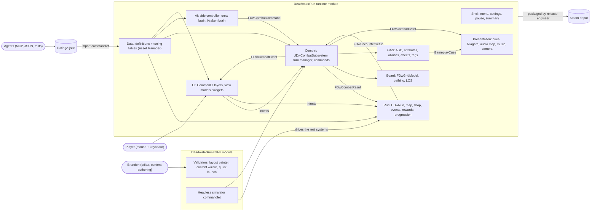
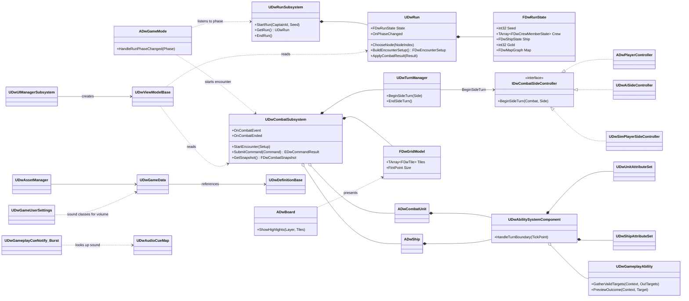
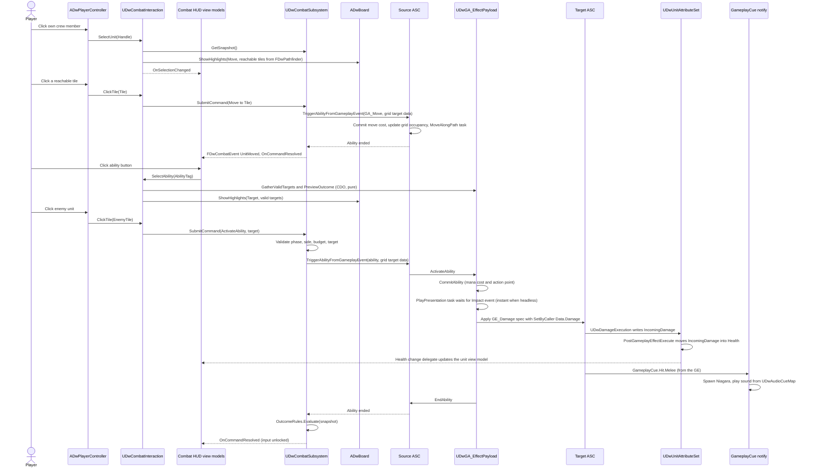
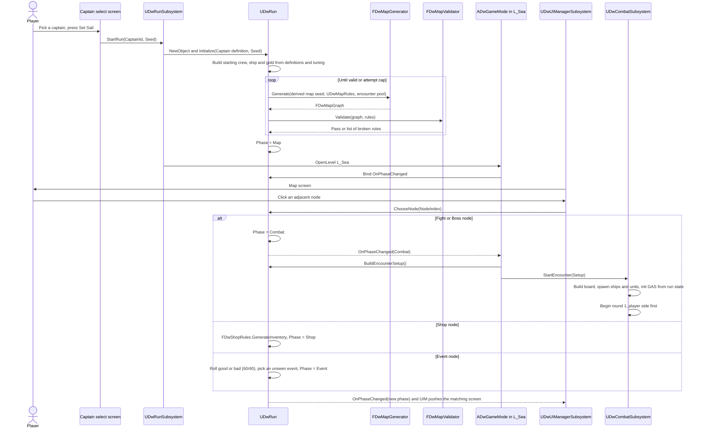
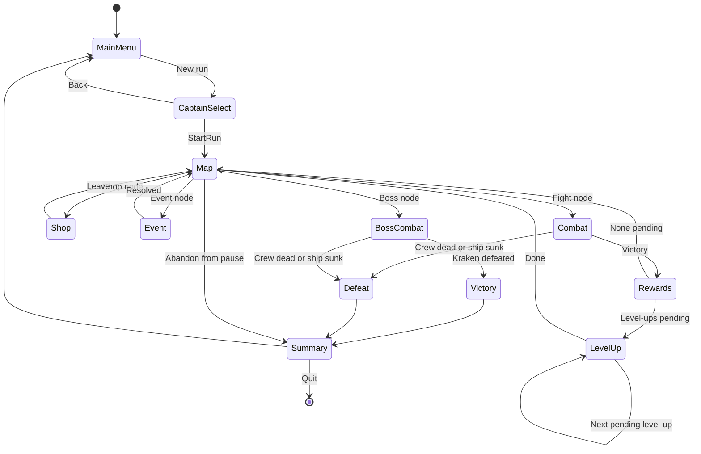
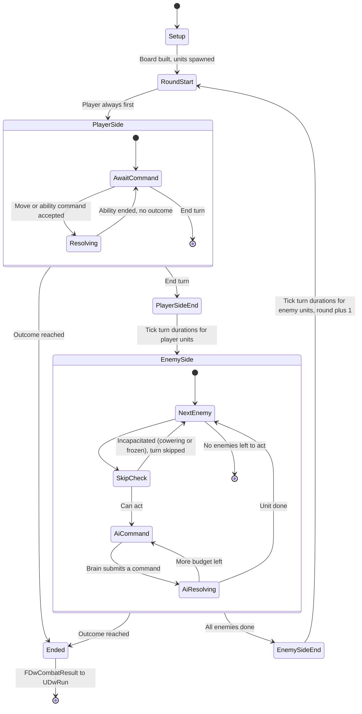

# 00 - Architecture Overview

- **Status:** Proposed (2026-10-24), waiting for Brandon's approval
- **Author:** technical-architect
- **Scope:** every system in `DeadwaterRun.md` and every "Must ship" item in `Docs/Scope.md` (v1.0, launch 2026-12-10)
- **Fixed decisions (Brandon, 2026-10-24):** 2 combat abilities per captain - 8-9 map nodes plus the boss, 5 fights guaranteed - square tile grid boards (one deck grid per ship, a boarding seam, an elevated nest tile; a separate Kraken arena) - level-up = a stat increase plus a pick of 1 from 2-3 perks taken from data-driven pools

## Index

| # | Document | One line |
|---|---|---|
| 00 | `00-Overview.md` | This file: modules, diagrams, class ownership, traceability |
| 01 | `01-Project-Structure.md` | Modules, folders, naming, template cleanup, build dependencies |
| 02 | `02-GAS-Foundation.md` | ASC, attribute sets, tags, effects, ability base classes, turn-based durations |
| 03 | `03-Combat-Turns.md` | Combat subsystem, turn manager, commands, outcomes, the combat event stream |
| 04 | `04-Grid-Board.md` | Grid model, deck layouts, boarding seam, nest, pathfinding, line of sight |
| 05 | `05-Crew-Captains.md` | Units, crew roster, the 3 captains, Fear, synergy, defend, run rules |
| 06 | `06-Ship-Cannons.md` | Ship HP, cannons, sinking, repair and upgrades |
| 07 | `07-Enemy-AI.md` | Side controllers, utility brain for enemy crews, AI profiles |
| 08 | `08-Kraken-Boss.md` | Kraken arena, body and tentacles, phases, intents |
| 09 | `09-Run-Map.md` | Run state, run flow, seeded map generation and node rules |
| 10 | `10-Economy-Shop-Loot.md` | Gold, sink/plunder/surrender multipliers, rewards, shop |
| 11 | `11-Events.md` | Event definitions, 60/40 roll, choices and outcomes |
| 12 | `12-Progression.md` | XP, levels, stat gains, perk pools |
| 13 | `13-Data-Layout.md` | DataAssets vs DataTables vs JSON, Asset Manager, tuning pipeline |
| 14 | `14-UI.md` | CommonUI layers, C++ view models, screen list, juice hooks |
| 15 | `15-Audio-VFX.md` | GameplayCues for VFX and SFX, audio cue map, music, mix |
| 16 | `16-Shell.md` | Levels, main menu, settings, pause, run summary, no mid-run saves |
| 17 | `17-Testing-Simulator.md` | Automation test layers, test world, headless run simulator |
| 18 | `18-Packaging-Release.md` | Shipping build, cook rules, Steam depots, release checklist |
| - | `Editor-Tools.md` | Every editor tool, plus "how Brandon adds X" guides |
| - | `Roadmap.md` | Week 0-6 plan, critical path, tickets |
| - | `Open-Questions.md` | Creative and design questions for Brandon, doc inconsistencies |

## The five rules every agent follows

1. **One source of truth per fact.** Run state lives in `FDwRunState`. Combat state lives in GAS attributes and tags plus `FDwGridModel`. Content lives in definition DataAssets. Numbers live in tuning DataTables imported from `Tuning/*.json`. No private copies.
2. **Commands in, events out.** The player, the enemy AI and the simulator all drive combat with the same `FDwCombatCommand` through `UDwCombatSubsystem::SubmitCommand`. UI, audio, VFX and stats all listen to the same outputs (GAS attribute delegates, GameplayCues, `FDwCombatEvent`).
3. **Pure rules, thin adapters.** Every rule (damage, pathing, line of sight, outcome, map generation, rewards, XP, shop, events, AI scoring) is a plain C++ function on value types, tested without a world. GAS classes and actors are thin adapters that call those functions.
4. **No tick-driven turn logic.** Turns advance only on events (command resolved, ability ended, side turn ended). Ticking is allowed only for presentation (animation, interpolation, VFX). With "instant presentation" on (tests, simulator), every latent step completes synchronously.
5. **Presentation through cues.** Gameplay code never spawns VFX or plays sounds. GameplayEffects and abilities fire GameplayCues; cue notifies play Niagara, and the shared audio cue map plays sound.

## Module layout

| Module | Type | Owner | Contents |
|---|---|---|---|
| `DeadwaterRun` | Runtime | gameplay-engineer (most folders; see table below) | All game code: Core, Abilities, Board, Combat, Run, Data, AI, UI, Presentation, Shell, Sim, Dev, Tests |
| `DeadwaterRunEditor` | Editor | tools-engineer | Validators, detail customizations, commandlets (tuning import, simulator, map sweep), editor menus, Editor Utility Widget support |

- No third module. A separate "rules" module was considered and rejected (see `01-Project-Structure.md`): folder discipline plus review gives the same separation without cross-module export overhead in a 6-week project.
- Class prefix: `Dw` (`UDwCombatSubsystem`, `FDwGridModel`, `ADwShip`).

## System context



## Main class diagram

Details per system live in the system documents. This shows how the big pieces connect.



## Sequence (a) - one crew member's turn

Input, to command, to GAS ability, to effect, to UI and cue. Movement and the action are two separate commands; either can be skipped.



## Sequence (b) - end of a fight to rewards to map

```mermaid
sequenceDiagram
    participant Attr as Attribute set (unit or ship)
    participant Combat as UDwCombatSubsystem
    participant Rules as FDwCombatOutcomeRules
    participant Run as UDwRun
    participant Reward as FDwRewardRules
    participant Prog as FDwProgressionRules
    participant UIM as UDwUIManagerSubsystem
    actor Player

    alt Enemy ship Health reaches 0
        Attr-->>Combat: OnShipSunk(EnemySide)
        Combat->>Combat: Kill every unit standing on enemy deck tiles (GE_Kill, no kill credit)
    else Last enemy unit dies
        Attr-->>Combat: OnUnitDied(Victim, Instigator)
        Combat->>Combat: Record kill credit and kill XP for Instigator
    else Every living enemy at max Fear (surrender rule on)
        Combat->>Combat: Detected after the command resolves
    end
    Combat->>Rules: Evaluate(snapshot, outcome config)
    Rules-->>Combat: VictorySunk or VictoryCrewDefeated or VictorySurrender or Defeat (ship sunk, crew dead, captain dead)
    Combat->>Combat: Stop turn manager, build FDwCombatResult (survivor HP, deaths, kills, rounds; MP refills next fight)
    Combat-->>Run: OnCombatEnded(Result)
    alt Defeat
        Run->>Run: Phase = Defeat
        Run-->>UIM: OnPhaseChanged(Defeat)
        UIM->>Player: Run summary screen
    else Victory
        Run->>Reward: ComputeRewards(Result, encounter tuning, economy, rng)
        Reward-->>Run: Gold x multiplier (sink 1x, plunder and surrender 1.5x), items, ability choices
        Run->>Prog: GrantXp(kill XP plus clear XP, captain XP rules)
        Prog-->>Run: Pending level-ups (stat gains plus perk choices)
        Run->>Run: Update captain counters (surrender wins, Conqueror kill bonus)
        Run->>Run: Phase = Rewards
        Run-->>UIM: OnPhaseChanged(Rewards)
        UIM->>Player: Rewards screen (gold, loot, pick a new ability)
        Player->>Run: ClaimRewards(choices)
        loop Each pending level-up
            Run-->>UIM: Phase = LevelUp
            UIM->>Player: Level-up screen (stat increase, pick 1 of 2-3 perks)
            Player->>Run: ChoosePerk(CrewId, PerkId)
        end
        Run->>Run: Mark node complete, Phase = Map
        Run-->>UIM: OnPhaseChanged(Map)
        UIM->>Player: Map screen with the next 2-3 choices
    end
```

## Sequence (c) - start a run, generate the map, enter a node



## State diagram - run flow



## State diagram - combat turn flow



## Class ownership by agent

Folders are under `Source/DeadwaterRun/` unless noted. "Content" means `Content/DeadwaterRun/`.

| Class / asset | Folder | Owner | Doc |
|---|---|---|---|
| `DwTags` native tags, `DwLog` categories, `DwTypes.h` (`EDwSide`, `FDwUnitHandle`, `EDwTurnTickPoint`) | `Core/` | gameplay-engineer | 02, 01 |
| `UDwAssetManager`, `UDwGameData`, `UDwDefinitionBase` | `Core/` | gameplay-engineer | 13 |
| `ADwGameMode`, `ADwMenuGameMode`, `ADwPlayerController` | `Core/` | gameplay-engineer | 03, 16 |
| `UDwAbilitySystemComponent`, `UDwUnitAttributeSet`, `UDwShipAttributeSet` | `Abilities/` | gameplay-engineer | 02 |
| `UDwGameplayAbility`, `UDwGA_Move`, `UDwGA_EffectPayload`, `UDwGA_FireCannon`, `UDwGA_UseItem`, `UDwGA_Grapple`, `UDwGA_Charge` | `Abilities/` | gameplay-engineer | 02, 05, 06 |
| `UDwDamageExecution`, `FDwDamageRules`, `UDwTurnDurationComponent`, `FDwGameplayAbilityTargetData_Grid`, `FDwTargetingRules`, `FDwTargetingQuery` | `Abilities/` | gameplay-engineer | 02 |
| `UDwAT_PlayPresentation`, `UDwAT_MoveAlongPath` | `Abilities/Tasks/` | gameplay-engineer | 02 |
| `FDwTile`, `FDwGridModel`, `FDwGridRules`, `FDwPathfinder`, `FDwLineOfSight`, `FDwBoardBuilder`, `UDwDeckLayout`, `ADwBoard` | `Board/` | gameplay-engineer | 04 |
| `UDwCombatSubsystem`, `UDwTurnManager`, `IDwCombatSideController`, `FDwCombatCommand`, `FDwCombatSnapshot`, `FDwCombatEvent`, `FDwCombatResult`, `FDwEncounterSetup`, `FDwCombatOutcomeRules`, `FDwFearRules` | `Combat/` | gameplay-engineer | 03, 05 |
| `ADwCombatUnit`, `ADwShip`, `UDwCombatInteraction` | `Combat/` | gameplay-engineer | 03, 05, 06 |
| `FDwOutcomeConfig`, `FDwCombatRecord` (seed + command list for replays) | `Combat/` | gameplay-engineer | 03 |
| `FDwRunState`, `FDwCrewMemberState`, `FDwShipState`, `FDwRunStats`, `UDwRun`, `UDwRunSubsystem`, `FDwRunRandom`, `FDwCrewFactory` | `Run/` | gameplay-engineer | 09, 10 |
| `FDwMapGraph`, `FDwMapNode`, `FDwMapGenerator`, `FDwMapValidator` | `Run/Map/` | gameplay-engineer | 09 |
| `FDwRewardRules`, `FDwShopRules`, `FDwShopInventory` | `Run/Economy/` | gameplay-engineer | 10 |
| `FDwEventResolver`, `UDwEventOutcome` (+ subclasses), `UDwEventRequirement` (+ subclasses) | `Run/Events/` | gameplay-engineer | 11 |
| `FDwProgressionRules`, `FDwCaptainRules` | `Run/` | gameplay-engineer | 12, 05 |
| Definitions: `UDwCaptainDefinition`, `UDwUnitDefinition`, `UDwAbilityDefinition`, `UDwAbilityPool`, `UDwItemDefinition`, `UDwPerkDefinition`, `UDwPerkPool`, `UDwEncounterDefinition`, `UDwKrakenDefinition`, `UDwEventDefinition`, `UDwShipUpgradeDefinition`, `UDwMapRules`, `UDwShopDefinition` | `Data/` | gameplay-engineer | 13 |
| Tuning row structs (`FDw*TuningRow`) except AI rows | `Data/Tuning/` | gameplay-engineer (schema) | 13 |
| `Tuning/*.json` values (repo root) | `Tuning/` | balance-designer | 13 |
| `UDwAiSideController`, `UDwAiBrain`, `UDwCrewAiBrain`, `UDwKrakenAiBrain`, `UDwAiProfile`, `FDwAiScoring`, `FDwAiCandidate`, `FDwAiIntent`, `FDwAiTuningRow` | `AI/` | ai-engineer | 07, 08 |
| `UDwPresentationSubsystem`, `UDwGameplayCueNotify_Burst`, `ADwGameplayCueNotify_Looping`, `ADwCameraRig` | `Presentation/` | gameplay-engineer | 15, 03 |
| `UDwAudioCueMap`, `UDwMusicSet` (C++ classes), `UDwMusicSubsystem` | `Presentation/` | gameplay-engineer | 15 |
| `DA_AudioCueMap`, `DA_MusicSet`, sound classes, mixes, concurrency (assets) | Content `Audio/` | sound-wrangler | 15 |
| Niagara systems, `GC_*` cue notify assets | Content `VFX/` | gameplay-engineer | 15 |
| `GA_*` / `GE_*` Blueprints, `BP_Unit_*`, `BP_Ship_*`, input assets, `L_MainMenu`, `L_Sea`, definition assets in Content `Data/` | Content | gameplay-engineer (art integration pending Open-Questions O1) | 02, 13, 16 |
| `UDwGameUserSettings` | `Shell/` | gameplay-engineer | 16 |
| `UDwHighlightPalette` (class, `Presentation/`, gameplay-engineer); `DA_HighlightPalette_*` colours (Content `UI/`, ui-engineer, Brandon signs off) | `Presentation/`, Content `UI/` | gameplay-engineer / ui-engineer | 14, 04 |
| `UDwUIManagerSubsystem`, `UDwPrimaryLayoutWidget`, `UDwActivatableScreen`, `UDwUserWidget`, `UDwViewModelBase` + all view models, `UDwUIScreenSet`, `UDwFloatingTextManager`, `UDwUISoundMap` (class) | `UI/` | ui-engineer | 14 |
| `WBP_*` widgets, fonts, UI textures | Content `UI/` | ui-engineer | 14 |
| Widget animations, `DA_UISoundMap` contents | Content `UI/` | ui-juice-engineer | 14 |
| `UDwRunDriver`, `UDwSimPlayerSideController`, `UDwSimPolicy`, `FDwSimRunReport` | `Sim/` | tools-engineer | 17 |
| `UDwDevSettings`, `UDwCheatManager` | `Dev/` | tools-engineer | Editor-Tools |
| `FDwTestWorld`, test helpers | `Tests/` | tools-engineer (rule tests: each system owner; regressions: qa-tester) | 17 |
| Editor module: `FDwEditorMenus`, `FDwDeckLayoutDetails`, `UDwContentValidator`, `UDwContentWizardSubsystem`, `UDwImportTuningCommandlet`, `UDwSimulateCommandlet`, `UDwMapSweepCommandlet`, `UDwMapPreviewLibrary`, `UDwSimReportLibrary`, `EUW_*` | `Source/DeadwaterRunEditor/`, Content `Dev/Tools/` | tools-engineer | Editor-Tools |
| `Build/`, packaging settings in `Config/DefaultGame.ini`, Steam scripts, `Docs/Release/` | repo | release-engineer | 18 |
| `Docs/Bugs/` | repo | qa-tester | 17 |
| `Docs/Balance/` | repo | balance-designer | 13, 17 |

## Traceability - every feature to a system doc and a ticket

Ticket IDs are defined in `Roadmap.md`.

| Feature (source) | Doc | Tickets |
|---|---|---|
| Pick 1 of 3 captains (DR Main loop, Scope Run loop) | 05, 16 | DW-201, DW-206, DW-207, DW-208, DW-210 |
| Map of fights, shops, events (DR Main loop) | 09 | DW-202, DW-211 |
| Kraken final boss, 500 HP (DR Boss) | 08 | DW-209, DW-301, DW-302, DW-303 |
| Team Leader: synergy moves | 05 | DW-207 |
| Team Leader: defend other crew | 05 | DW-207 |
| Team Leader: Rally Cry, Grapple Hook (range 10, viewing distance) | 05, 04 | DW-207 |
| Team Leader: Veteran Crew XP rule | 05, 12 | DW-203, DW-207 |
| Fearmongerer: Fear stacks, cower at 3 | 05 | DW-206 |
| Fearmongerer: surrender (third outcome, plunder, nobody dies) | 05, 03, 10 | DW-206, DW-203 |
| Fearmongerer: Smoke and Fire, Six Pistols | 05 | DW-206 |
| Fearmongerer: Dread Reputation | 05 | DW-206 |
| Conqueror: extra move, stronger captain | 05 | DW-208 |
| Conqueror: sword only | 05 | DW-208 |
| Conqueror: crew single choice per turn | 05, 02 | DW-208 |
| Conqueror: Charge, Eye of the Tiger | 05 | DW-208 |
| Conqueror: +1% damage per own kill, max 20% | 05, 12 | DW-208 |
| Ship 250 HP, two cannons, 70 damage (DR Your Ship) | 06 | DW-103, DW-104 |
| Ship repair and upgrades at shop | 06, 10 | DW-204, DW-304 |
| Crew of three, 100 HP / 20 MP; captain, swordsman, sniper | 05, 13 | DW-103, DW-112, DW-201 |
| Permadeath crew | 05, 09 | DW-103, DW-201 |
| Disband and recruit at shop, max crew of 4 | 10, 05 | DW-204 |
| Upgrade crew with new abilities | 10, 12 | DW-203, DW-204 |
| Crews spawn on own ships, ships adjacent, boarding | 04 | DW-102, DW-103 |
| No using the other side's cannons | 06 | DW-104 |
| Move and action in any order, skip allowed (one move per turn, C3) | 02, 03 | DW-101, DW-103, DW-104 |
| 5 move spaces per turn unless specified | 02, 04 | DW-101, DW-102 |
| Sniper's nest (elevated, LOS, range, hiding) | 04 | DW-102 |
| Crew on enemy ship die when it sinks | 06, 03 | DW-103 |
| Gold and abilities on victory, sink 1x, spare 1.5x | 10 | DW-203 |
| Kill XP to killer, clear XP to all crew | 12 | DW-203 |
| Level-up: stat increase plus 1 of 2-3 perks (data pools) | 12 | DW-203, DW-211, DW-304 |
| Events 60% good / 40% bad, ~10-12 events | 11 | DW-205, DW-211, DW-306 |
| 8-9 nodes, 5 fights guaranteed | 09 | DW-202 |
| No two shops or two events in a row, shop before boss | 09 | DW-202 |
| 2-3 next choices, forward only, visited marked | 09, 14 | DW-202, DW-211 |
| Player always starts first | 03 | DW-103 |
| Actions: attack, ability (MP), item, cannon | 02, 06 | DW-104 |
| Win by sinking or crew wipe; lose on crew wipe, ship sunk or captain death (C10) | 03 | DW-103 |
| Plunder on crew wipe (gold and/or random item) | 10 | DW-203 |
| Shop: repair 100g, abilities 50g, items 30g | 10 | DW-204 |
| Kraken: tentacle targeting reduces actions or damage | 08 | DW-301, DW-302 |
| Kraken initial phase moves (slam, swipe, grab) | 08 | DW-301, DW-302 |
| Kraken enraged phase below 30% (Arms of Fury, Eyes of the Sea) | 08 | DW-301, DW-302 |
| Content: 4-5 enemy crews (Scope) | 07, 13 | DW-305 |
| Content: ~12 crew abilities (Scope) | 02, 13 | DW-304 |
| Content: 2 items, health and mana restore (Scope) | 10, 13 | DW-104, DW-304 |
| Shell: main menu, settings, pause, run summary (Scope) | 16, 14 | DW-210, DW-216 |
| No mid-run saves (Scope) | 16 | DW-210 |
| Synty Pirate + VFX art (Scope Presentation) | 15, 01 | DW-005, DW-307 |
| Readable combat UI (Scope) | 14 | DW-107, DW-303, DW-402 |
| Hit and cannon VFX (Scope) | 15 | DW-114, DW-307 |
| Audio (Scope), audio source decided Nov 8 | 15 | DW-005, DW-113, DW-311, DW-403 |
| Steam: store page Nov 19, live Nov 26, build Dec 2, launch Dec 10 | 18 | DW-006, DW-116, DW-218, DW-308, DW-406, DW-501, DW-601 |
| Editor tools so Brandon adds content without AI (this request) | Editor-Tools | DW-108, DW-109, DW-110, DW-111, DW-213, DW-309 |
| Headless simulator and balance from simulations (Scope week 4) | 17, 13 | DW-212, DW-309, DW-401 |

**Check result:** every feature bullet in `DeadwaterRun.md` and every Must-ship item in `Docs/Scope.md` maps to at least one system doc and one ticket. Items whose details are still undecided are tracked in `Open-Questions.md`, and the architecture keeps their answers in data.
