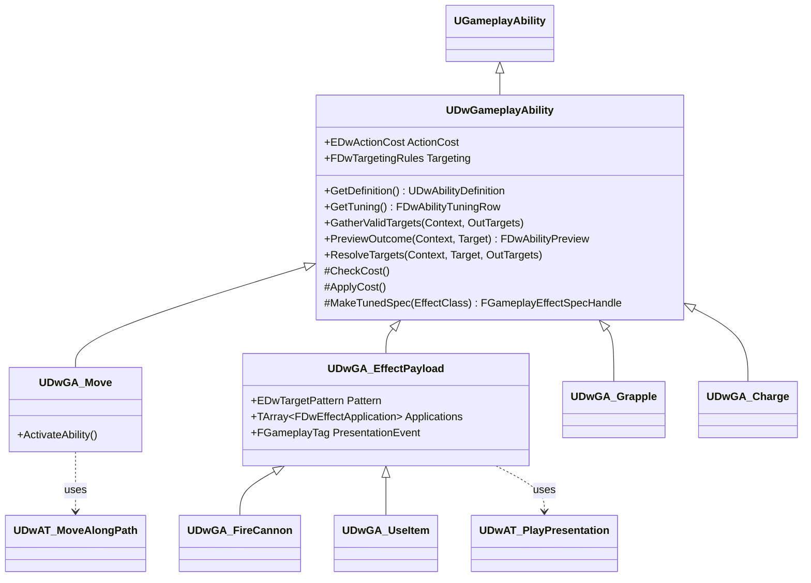

# 02 - GAS Foundation

Attributes, tags, effects, ability base classes and turn-based durations. Every combat system builds on this.

## Problem
- Combat needs HP/MP, damage, heals, statuses (Fear, frozen, rooted, cowering, guarded), costs and a per-turn action budget - for crew, enemies, ships, the Kraken and tentacles alike.
- GAS durations are time-based; our game counts turns. Turn logic must not tick.
- The same abilities must run in the game (with animation) and in tests and the simulator (instantly, no rendering).

## Decisions

### D1 - Where the ASC lives
| Option | Verdict |
|---|---|
| **A. ASC on each combat actor (`ADwCombatUnit`, `ADwShip`); persistent stats live in `FDwRunState` and are written into GAS at spawn and read back at fight end** | **Chosen.** Units are per-fight actors; the run is pure data. Simple, single-player, no PlayerState needed |
| B. ASC on a persistent per-crew UObject/PlayerState carried across fights | Rejected: ASCs need an owning actor; carrying them across encounters means stale effects and cleanup bugs |
| C. No GAS for ships (plain int HP) | Rejected: cannons, repairs, upgrades and Kraken slams are effects too; one damage pipeline for everything |

### D2 - Turn-based durations
| Option | Verdict |
|---|---|
| **A. Infinite-duration GE + `UDwTurnDurationComponent` (a `UGameplayEffectComponent`) that declares N turns and a tick point; each ASC counts down at turn boundaries the turn manager announces** | **Chosen.** Uses Epic's GE component extension point (UE 5.3+), event-driven, visible in the GE asset |
| B. Time-based durations with a fake clock | Rejected: hidden coupling to time, breaks pause and instant mode |
| C. Use stack count as "turns remaining" | Rejected: conflicts with real stacking, unreadable |

### D3 - Action economy
| Option | Verdict |
|---|---|
| **A. `ActionPoints` and `MovePoints` attributes, refilled at the start of the owner's side turn; abilities pay them as costs** | **Chosen.** GAS `CanActivate` and cost checks do the work; Conqueror extra move and crew single-choice become data (see `05-Crew-Captains.md`) |
| B. Booleans in the turn manager | Rejected: duplicates GAS cost logic, UI must query two places |

### D4 - Ability shape
| Option | Verdict |
|---|---|
| **A. A small set of C++ ability classes (`UDwGA_EffectPayload` covers most), with each content ability as a Blueprint subclass that only sets defaults, numbers from tuning rows** | **Chosen.** Brandon adds abilities without code; logic stays in C++ |
| B. One C++ class per ability | Rejected: ~25 abilities x code review; Brandon can't add any |
| C. Fully generic "effect graph" framework | Rejected: speculative framework |

## Attribute sets

`UDwUnitAttributeSet` (crew, enemies, Kraken body, tentacles)

| Attribute | Meaning | Initialised from |
|---|---|---|
| `Health`, `MaxHealth` | HP (crew start 100) | Unit tuning row + level gains; `Health` from run state for crew |
| `Mana`, `MaxMana` | MP (crew start 20) | Tuning + level gains; `Mana` always starts each fight at `MaxMana` (C9), no regen |
| `AttackDamage` | Base damage of the basic attack | Unit tuning row + level gains |
| `DamageBonus` | Additive % damage (Conqueror kill bonus, perks) | GEs |
| `DamageReduction` | Additive % damage taken reduction (perks, defend variants) | GEs, clamp 0..0.9 |
| `MoveRange` | Tiles per turn (default 5) | Unit tuning row |
| `MovePoints` | Movement left this turn | Refilled to `MoveRange` at side-turn start |
| `MaxActionPoints`, `ActionPoints` | Actions per turn (default 1; the Conqueror has 2, K1) and left this turn | Unit tuning row + `GE_ConquerorExtraMove`; refilled at side-turn start |
| `Fear`, `MaxFear` | Fear stacks and cower threshold (3) | `MaxFear` from combat tuning |
| `IncomingDamage`, `IncomingHeal` | Meta attributes (not persisted) | Written by execs/GEs |

`UDwShipAttributeSet`: `Health`, `MaxHealth` (250), `CannonDamage` (70), `IncomingDamage`.

Rules in the sets:
- `PreAttributeChange` clamps (`Health` 0..`MaxHealth`, `Fear` 0..`MaxFear`, points >= 0).
- `PostGameplayEffectExecute` moves `IncomingDamage` (after `DamageReduction`) into `Health`, `IncomingHeal` into `Health`; on `Health` reaching 0 it adds `State.Dead` and calls `UDwAbilitySystemComponent::NotifyHealthDepleted(Instigator)` once. The combat subsystem turns that into death handling.
- Fear sets/clears the loose tag `Status.Afraid` when `Fear` crosses 0, so abilities can condition on "already afraid" with a tag requirement.

## Damage pipeline
- `GE_Damage` (instant) uses `UDwDamageExecution : UGameplayEffectExecutionCalculation`.
- The exec captures source `AttackDamage`, `DamageBonus`, target `DamageReduction`, reads SetByCaller `Data.Damage` (flat) and `Data.DamageScale` (multiplier of `AttackDamage`), then calls the pure function below and outputs to `IncomingDamage`.
- `FDwDamageRules::Compute(const FDwDamageInput&) -> FDwDamageOutput` - pure: flat + scaled base, `x (1 + DamageBonus)`, situational multipliers passed in (synergy, K4), `x (1 - DamageReduction)`, round to int, minimum 0. Same function powers UI damage previews and AI scoring, so previews never lie. Elevation gives range only, not damage.
- Synergy (K4, decided): the caller passes `SynergyMultiplier` = captain tuning `SynergyDamageMultiplier` when `FDwSynergyRules::IsActive(Grid, SourceTile, SourceSide, CaptainRuleTags)` is true (an ally on a 4-way neighbour of the source tile and the side's captain has `Rule.Captain.Synergy`), else 1. The exec gets the source tile from the combat subsystem; `PreviewOutcome` passes the hypothetical source tile, so "move here, then attack" previews include synergy. Which damage it applies to is K4a (placeholder: every ability with `Ability.Attack.*` or a damaging crew ability, not cannons).
- Ships use the same `GE_Damage`; the exec checks for `UDwShipAttributeSet` and skips unit-only terms.

## Turn-based durations
- `UDwTurnDurationComponent : UGameplayEffectComponent` - `int32 Turns` (overridable by SetByCaller `Data.Turns`), `EDwTurnTickPoint TickPoint` (`OwnerSideTurnStart`, `OwnerSideTurnEnd`).
- `UDwAbilitySystemComponent` records active effects that carry this component (via `OnActiveGameplayEffectAddedDelegateToSelf`) in `TMap<FActiveGameplayEffectHandle, int32> TurnsRemaining`.
- `UDwTurnManager` calls `HandleTurnBoundary(TickPoint)` on every ASC of the side whose turn starts or ends. The ASC decrements and removes expired effects. No timers, no tick.
- Convention (C15, decided): "for one turn" = `Turns=1, TickPoint=OwnerSideTurnEnd` - the effect lasts through the target's next side turn and is removed at its end.
- Rule that makes the convention hold for every case: an effect applied **during its owner's own side turn** is not decremented at the end of that same turn (the ASC stores the side-turn index at application and skips the boundary of that turn). Without it, Eyes of the Sea (the Kraken buffs itself on its own turn) and any self-side buff would expire before the turn it was meant for. Changed 2026-10-25; covered by a test below.
- `GE_Guarded` (Defend) is the one exception: it uses `TickPoint=OwnerSideTurnStart` so it protects through the enemy turn and ends when the guarded ally's side starts its next turn (K5 placeholder).

## Tags (native in `Core/DwGameplayTags`, content-only tags in `Config/DefaultGameplayTags.ini`)

| Namespace | Examples | Used by |
|---|---|---|
| `Ability.*` | `Ability.Move`, `Ability.Attack.Melee`, `Ability.Attack.Ranged`, `Ability.Cannon`, `Ability.Item`, `Ability.Captain.RallyCry` | Ability identity in commands, UI, AI |
| `Ability.Weapon.*` | `Ability.Weapon.Sword`, `Ability.Weapon.Firearm` | Conqueror weapon restriction (data) |
| `Status.*` | `Status.Afraid`, `Status.Incapacitated.Cowering`, `Status.Incapacitated.Frozen`, `Status.Rooted`, `Status.Guarded` | Blocking, AI, UI icons |
| `State.*` | `State.Dead`, `State.OnEnemyDeck`, `State.InNest`, `State.Synergy.Adjacent` | Derived combat state |
| `Effect.*` (GE asset tags) | `Effect.Debuff`, `Effect.Buff`, `Effect.Perk` | Rally Cry cleanse via `URemoveOtherGameplayEffectComponent` |
| `Unit.*` | `Unit.Role.Captain`, `Unit.Archetype.Swordsman`, `Unit.Archetype.Sniper`, `Unit.Kraken.Body`, `Unit.Kraken.Tentacle`, `Unit.Immune.Fear` | Targeting filters, rules |
| `Rule.*` | `Rule.Captain.Synergy`, `Rule.Captain.Defend`, `Rule.Captain.Surrender`, `Rule.Captain.KillBonus`, `Rule.Captain.VeteranCrew`, `Rule.Captain.DreadReputation`, `Rule.Turn.SingleChoice` | Captain rules (data) |
| `Tile.*` | `Tile.Deck`, `Tile.Nest`, `Tile.Ladder`, `Tile.Cannon`, `Tile.BoardingEdge`, `Tile.Water`, `Tile.Spawn.Player`, `Tile.Spawn.Enemy`, `Tile.Kraken.Body`, `Tile.Kraken.Tentacle` | Board, targeting |
| `Event.*` | `Event.Ability.Activate`, `Event.Presentation.Impact` | Gameplay events |
| `Data.*` | `Data.Damage`, `Data.DamageScale`, `Data.Heal`, `Data.Fear`, `Data.Turns`, `Data.Cost.Mana`, `Data.Cost.Move`, `Data.DamageBonus` | SetByCaller |
| `GameplayCue.*` | `GameplayCue.Hit.Melee`, `GameplayCue.Hit.Ranged`, `GameplayCue.Cannon.Fire`, `GameplayCue.Cannon.Impact`, `GameplayCue.Ship.Sink`, `GameplayCue.Unit.Death`, `GameplayCue.Unit.Heal`, `GameplayCue.Status.*`, `GameplayCue.Kraken.*` | VFX and audio |
| `UI.Layer.*` | `UI.Layer.Game`, `UI.Layer.GameMenu`, `UI.Layer.Menu`, `UI.Layer.Modal` | UI stacks |

- Code references tags only through `DwTags::` natives. A new content tag (e.g. a new status) is added in Project Settings > GameplayTags, which writes `DefaultGameplayTags.ini`.

## Shared GameplayEffects (Blueprint assets in `Content/DeadwaterRun/Abilities/Effects/`)

| GE | Type | Purpose |
|---|---|---|
| `GE_InitUnitStats`, `GE_InitShipStats` | Instant, SetByCaller per attribute | Write run-state values at spawn |
| `GE_Damage`, `GE_Heal`, `GE_RestoreMana` | Instant | Damage via exec, heal via `IncomingHeal`, mana |
| `GE_AddFear` | Instant, `Fear += Data.Fear` | Fear stacks |
| `GE_Cleanse` | Instant, `URemoveOtherGameplayEffectComponent` for asset tag `Effect.Debuff` | Rally Cry and cleanse items/perks |
| `GE_Cowering`, `GE_Frozen` | Infinite + turn duration 1, grant `Status.Incapacitated.*`, asset tag `Effect.Debuff` | Skip turn |
| `GE_Rooted` | Infinite + turn duration 1, grants `Status.Rooted` | Kraken grab |
| `GE_Guarded` | Infinite + turn duration 1 (tick `OwnerSideTurnStart`), grants `Status.Guarded`; instigator = guardian | Team Leader defend |
| `GE_ConquerorExtraMove` | Infinite, `MaxActionPoints += 1` (K1: a second action per turn, same single move) | Conqueror |
| `GE_TurnBudgetRefresh` | Instant, override `ActionPoints`/`MovePoints` to max | Side-turn start |
| `GE_Cost_Action`, `GE_Cost_Move`, `GE_Cost_Mana` | Instant cost | Ability costs |
| `GE_SpendAll` | Instant, zero both points | Single-choice rule |
| `GE_Kill` | Instant, `IncomingDamage` = huge, no instigator | Sinking kills |
| `GE_DamageBonus` | Infinite, `DamageBonus += Data.DamageBonus` | Conqueror kill bonus, perks |

`UDwGameData` holds references to these classes so C++ never hard-codes asset paths.

## Ability classes

`UDwGameplayAbility` (abstract base)
- Instancing: `InstancedPerActor`. Net execution: local only (single-player).
- Definition: the `UDwAbilityDefinition` is the spec's `SourceObject` (set when granted). `GetTuning()` reads the definition's row from `DT_AbilityTuning`.
- `ActionCost`: `Action` (pays 1 `ActionPoints`), `Move` (pays path cost in `MovePoints`), `Free`.
- `CheckCost/ApplyCost` override: mana cost through `GE_Cost_Mana` (SetByCaller from tuning) plus action/move points. If the owner has `Rule.Turn.SingleChoice`, paying either kind also applies `GE_SpendAll` to the other kind.
- Blocking: `ActivationBlockedTags` default to `Status.Incapacitated` and `State.Dead`; `UDwGA_Move` also blocks on `Status.Rooted`.
- Targeting: `FDwTargetingRules` (asset) + range from tuning. `GatherValidTargets` and `PreviewOutcome` are `const` and run on the CDO against an `FDwTargetingContext` (snapshot + grid + source handle) - pure, used by UI, AI and the simulator.
- `ResolveTargets` applies redirects (defend: a single-target hit on a `Status.Guarded` unit goes to the guardian if alive and in place) and returns final targets.
- `MakeTunedSpec` builds a GE spec and fills every standard SetByCaller (`Data.Damage`, `Data.DamageScale`, `Data.Heal`, `Data.Fear`, `Data.Turns`) from the tuning row, so each GE uses what it needs.

`FDwTargetingRules` (USTRUCT, on the ability CDO): `EDwTargetPattern Pattern` (`Self`, `SingleUnit`, `SingleUnitOrShip`, `EnemyShip`, `Tile`, `AllEnemies`, `AllAllies`, `RandomEnemies`, `Line`), `EDwTargetSide Side` (`Enemy`, `Ally`, `Any`), `bool bRequiresLineOfSight`, `bool bIgnoreRange`, `bool bCanTargetElevated`, `FGameplayTagContainer RequiredSourceTileTags`, `FGameplayTagContainer RequiredTargetTags`, `FGameplayTagContainer BlockedTargetTags`. Range, min/max hits come from tuning.

`UDwGA_EffectPayload` - the workhorse
- `Applications`: ordered `TArray<FDwEffectApplication>`; each has `TSubclassOf<UGameplayEffect> Effect`, `FGameplayTagContainer RequiredTargetTags`, `BlockedTargetTags`, `bApplyToSelf`.
- Flow: commit -> `UDwAT_PlayPresentation` (montage, waits for `Event.Presentation.Impact`) -> resolve targets (random patterns draw from the combat random stream) -> apply each application in order -> end.
- Covers: basic melee and ranged attacks, Rally Cry (heal all allies, then `GE_Cleanse` removing `Effect.Debuff`), Smoke and Fire (damage if `Status.Afraid`, then `GE_AddFear` - order matters, it is data), Six Pistols (`RandomEnemies`, hits = 6), Eye of the Tiger (`SingleUnit`, `bIgnoreRange`, no LOS, `GE_Frozen`), defend (`GE_Guarded` on ally) and all Kraken moves.

Code subclasses (logic that data can't express)
- `UDwGA_Move` - takes a tile target, asks `FDwPathfinder` for the path, pays path cost, then zeroes the remaining `MovePoints` (one move per turn, C3), updates grid occupancy at commit (logic is instant), then `UDwAT_MoveAlongPath` animates.
- `UDwGA_FireCannon` - requires the unit on or 4-way adjacent to an unused `Tile.Cannon` owned by its side (C7); uses the action; marks that cannon used this side turn (combat subsystem); target is the enemy ship only; damage from ship `CannonDamage`. See `06-Ship-Cannons.md`.
- `UDwGA_UseItem` - item id in the event payload; consumes from run inventory via the combat subsystem; applies the item definition's GE.
- `UDwGA_Grapple` - pull target to the tile next to the source, or pull source to the tile next to the target; line of sight + range 10 from tuning.
- `UDwGA_Charge` - dash in a straight line up to N tiles, stop at the first enemy, apply heavy damage.

## Activation and target data
- `FDwGameplayAbilityTargetData_Grid : FGameplayAbilityTargetData` - `FIntPoint Tile`, `FDwUnitHandle Unit`, `FName ItemId`.
- The combat subsystem activates with `ASC->TriggerAbilityFromGameplayEvent(SpecHandle, ActorInfo, DwTags::Event_Ability_Activate, &Payload, *ASC)`. Abilities never read input directly.
- Every ability ends via `EndAbility`; `UDwAbilitySystemComponent::OnAbilityEnded` tells the combat subsystem the command resolved.

## Presentation tasks and instant mode
- `UDwPresentationSubsystem` (world subsystem) exposes `IsInstant()` and `GetPlaybackRate()` (game-speed setting).
- `UDwAT_PlayPresentation` plays the montage set on the ability and waits for the `Event.Presentation.Impact` anim notify; in instant mode it fires `OnImpact` and `OnCompleted` synchronously.
- `UDwAT_MoveAlongPath` interpolates the actor along the tile path (presentation tick only); in instant mode it snaps.
- In instant mode every ASC sets `bSuppressGameplayCues = true`.
- Rule: abilities change game state only at well-defined points (commit, impact, end). Animation timing never decides an outcome.

## Connections
- `03-Combat-Turns.md`: commands -> activation; ability end -> outcome check; turn boundaries -> duration countdown and budget refresh.
- `04-Grid-Board.md`: targeting and movement call the pure grid queries.
- `05-Crew-Captains.md`, `06-Ship-Cannons.md`, `08-Kraken-Boss.md`: content abilities are subclasses/BPs of these classes.
- `07-Enemy-AI.md`: AI uses `GatherValidTargets` and `PreviewOutcome`.
- `12-Progression.md`: perks are infinite GEs (`Effect.Perk`) applied at spawn.
- `13-Data-Layout.md`: tuning rows feed SetByCallers.
- `14-UI.md`: unit view models bind to attribute change delegates; previews come from `PreviewOutcome`.
- `15-Audio-VFX.md`: GEs and abilities carry GameplayCue tags.

## Build order (all gameplay-engineer unless noted)
1. DW-004: native tags, `UDwGameData` slots for shared GE classes.
2. DW-101: ASC, both attribute sets, `UDwDamageExecution` + `FDwDamageRules`, `UDwTurnDurationComponent` + ASC countdown, shared GEs, `UDwGameplayAbility` base with cost/budget handling, target data struct.
3. DW-104: `UDwGA_Move`, `UDwGA_EffectPayload`, `UDwGA_FireCannon`, `UDwGA_UseItem`, both presentation tasks, `UDwPresentationSubsystem`.
4. DW-206/207/208: captain abilities (`UDwGA_Grapple`, `UDwGA_Charge` + BP payload abilities).

## How it's tested
- Pure (`DeadwaterRun.Rules.Damage.*`): `FDwDamageRules` table tests (bonus, reduction, rounding, zero floor).
- GAS in a test world (`DeadwaterRun.Gas.*`, using `FDwTestWorld`):
  - Damage reduces Health; Health 0 adds `State.Dead` and notifies once.
  - A 1-turn `GE_Frozen` applied on the player turn survives the enemy side-turn start and is gone after its end.
  - A 1-turn effect applied during its owner's own side turn survives that turn's end and expires at the end of the owner's next turn (Eyes of the Sea case).
  - `GE_Guarded` applied on the player turn lasts through the enemy turn and is gone at the next player turn start.
  - After `UDwGA_Move`, `MovePoints` is 0 even if the path cost was below `MoveRange`.
  - Mana and action costs block activation when short; single-choice rule zeroes the other budget.
  - `Status.Afraid` toggles with Fear; Rally Cry removes all `Effect.Debuff` effects.
  - Instant mode: an ability activates and ends in the same call stack.

## What the player sees
- Health and mana bars that drop exactly when the sword lands, status icons that show "frozen - 1 turn", greyed-out buttons with a reason ("Not enough MP"), and damage previews that always match the result.
