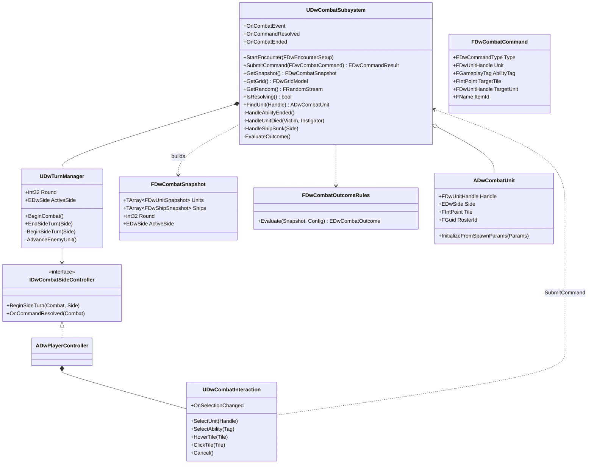

# 03 - Combat and Turn Manager

## Problem
- One combat loop must serve the player, the enemy AI, the Kraken, automation tests and a headless simulator that plays thousands of runs.
- Rules: player side always first; each crew member moves (5 tiles default) and takes one action in any order, either can be skipped; actions are attack, ability (MP), item, cannon; win by sinking the enemy ship or killing the crew (or surrender, Fearmongerer); lose if all crew die or your ship sinks.
- No tick-driven turn logic; input must lock while an action plays.

## Decisions

### D1 - Who drives combat
| Option | Verdict |
|---|---|
| **A. Command pattern: every actor (player input, AI, simulator) submits `FDwCombatCommand` to `UDwCombatSubsystem`; sides are driven through `IDwCombatSideController`** | **Chosen.** One validated entry point, deterministic, replayable, simulator-ready |
| B. Player controller and AI call abilities directly | Rejected: duplicated validation, no single place to lock input or record runs |
| C. StateTree/BehaviorTree drives the round | Rejected: tick-based, world-bound, hard to test headless |

### D2 - Where combat state lives
| Option | Verdict |
|---|---|
| **A. `UDwCombatSubsystem` (`UWorldSubsystem`) owns the turn manager, grid and unit registry; GAS owns attributes and tags; `FDwCombatSnapshot` is a pure copy for rules/AI/UI** | **Chosen.** Exists in any game world, including the simulator's transient world |
| B. A placed `ADwCombatManager` actor | Rejected: must be placed in every level and test, easy to forget |
| C. On the game mode | Rejected: game mode is level glue; simulator would need one |

### D3 - Turn order inside a side
| Option | Verdict |
|---|---|
| **A. Player side: any unit in any order, interleaved, until End Turn. Enemy side: units act one at a time in `UDwEncounterDefinition` order** | **Chosen.** Matches "during a player's turn they can move and take an action for each party member" |
| B. Initiative order per unit | Rejected: not in the design |

## Classes



### `UDwCombatSubsystem : UWorldSubsystem` (Combat/)
- `StartEncounter(const FDwEncounterSetup&)`: builds `FDwGridModel` via `FDwBoardBuilder`, spawns `ADwBoard`, ships and units, initialises GAS from run state (`GE_InitUnitStats`, perks, captain rule GEs, starting Fear), seeds `FRandomStream` from `Setup.Seed`, then `TurnManager->BeginCombat()`.
- `SubmitCommand`: rejects if `IsResolving()`, wrong side, unit dead or not owned by the active side, ability missing, target not in `GatherValidTargets`, or cost unaffordable. Returns `EDwCommandResult` (`Accepted`, `Busy`, `NotYourTurn`, `InvalidUnit`, `InvalidTarget`, `CannotAfford`, `Blocked`). Accepted commands are appended to `FDwCombatRecord` (seed + command list, for replays).
- `EndUnit` marks a unit done (UI convenience only); `EndTurn` calls `TurnManager->EndSideTurn`.
- After each ability ends: rebuild derived state (synergy adjacency, deck ownership tags), evaluate outcome, broadcast `OnCommandResolved`.
- Unit registry: `TArray<TObjectPtr<ADwCombatUnit>> Units`, `TStaticArray<TObjectPtr<ADwShip>, 2> Ships` (enemy ship null in the Kraken fight), cannons used this side turn.
- Teardown: `EndEncounter()` destroys spawned actors after `OnCombatEnded` listeners have read the result.

### `UDwTurnManager : UObject` (owned by the subsystem)
- `BeginCombat` -> round 1 -> `BeginSideTurn(Player)`.
- `BeginSideTurn(Side)`: apply `GE_TurnBudgetRefresh` to the side's units, `HandleTurnBoundary(OwnerSideTurnStart)` on the side's ASCs, emit `TurnStarted`, call the side controller's `BeginSideTurn`.
- Enemy side: for each enemy unit in order, skip if `Status.Incapacitated` (cowering: also apply the Fear-after-cower policy, see `05-Crew-Captains.md`), else ask the controller to act for that unit; `AdvanceEnemyUnit` runs on `OnCommandResolved` after the unit reports done.
- Cower check happens at the unit's turn start: if `Fear >= MaxFear` and the unit is not immune, apply `GE_Cowering` and skip.
- `EndSideTurn(Side)`: `HandleTurnBoundary(OwnerSideTurnEnd)` on the side's ASCs, then the other side's turn; after the enemy side, `Round++`.
- No timers and no tick. Every transition is a function call from a command, an ability end or a side controller.

### `IDwCombatSideController` (UInterface)
| Implementation | Owner | Behaviour |
|---|---|---|
| `ADwPlayerController` | gameplay-engineer | Unlocks input, HUD shows "Your turn"; commands come from `UDwCombatInteraction` |
| `UDwAiSideController` | ai-engineer | Asks the unit's brain for the next command until it ends the unit |
| `UDwSimPlayerSideController` | tools-engineer | Simulator policy plays the player side |

The "loop until latent" pattern (avoids recursion in instant mode):
```
while (!bUnitDone)
{
    const FDwCombatCommand Command = Brain->ChooseNextCommand(Combat.GetSnapshot(), Unit, Rng);
    Combat.SubmitCommand(Command);
    if (Combat.IsResolving()) { return; }   // game: resume in OnCommandResolved
}                                           // instant mode: keep looping synchronously
```

### Pure types (Combat/, no world)
- `FDwCombatCommand` - see diagram. `EDwCommandType`: `Move`, `Ability`, `EndUnit`, `EndTurn`. Move is the `Ability.Move` ability.
- `FDwCombatSnapshot` - units (`FDwUnitSnapshot`: handle, side, tile, Health/Max, Mana/Max, Fear/Max, Action/Move points, tags, granted ability tags, definition id, bAlive), ships (side, Health/Max, cannon tiles), grid copy, round, active side, outcome config. Built on demand; cheap (fewer than 20 units).
- `FDwCombatEvent` - `EDwCombatEventType` (`UnitDamaged`, `UnitHealed`, `UnitDied`, `UnitMoved`, `ShipDamaged`, `ShipSunk`, `StatusApplied`, `StatusRemoved`, `FearChanged`, `TurnStarted`, `UnitTurnSkipped`, `AbilityUsed`, `IntentDeclared`, `OutcomeReached`), source, target, magnitude, tag. Consumers: floating text, combat log, run stats, simulator report, QA replays.
- `FDwEncounterSetup` - encounter definition, crew states, ship state, captain definition and rule tags, starting Fear, conqueror bonus, seed, inventory view.
- `FDwCombatResult` - outcome, rounds, per-crew survivor Health/Mana, dead roster ids, kills (killer roster id -> victim definitions), ship Health, items used.
- `FDwCombatOutcomeRules::Evaluate(const FDwCombatSnapshot&, const FDwOutcomeConfig&)` -> `EDwCombatOutcome` (`None`, `VictorySunk`, `VictoryCrewDefeated`, `VictorySurrender`, `VictoryBoss`, `DefeatCrewDead`, `DefeatShipSunk`).

Outcome priority (pure, unit-tested; Open-Questions C12 may change the order - it is one ordered list in code):
1. Player ship Health 0 -> `DefeatShipSunk`.
2. No living player crew -> `DefeatCrewDead` (includes boarders killed by sinking the enemy ship).
3. Kraken body dead -> `VictoryBoss`.
4. Enemy ship Health 0 -> `VictorySunk` (1x loot).
5. No living enemy units -> `VictoryCrewDefeated` (plunder, 1.5x).
6. Surrender enabled and every living enemy at `MaxFear` -> `VictorySurrender` (plunder, nobody dies).

### Death and sinking
- Unit death: attribute set -> ASC `NotifyHealthDepleted(Instigator)` -> `HandleUnitDied`: tags `State.Dead`, frees the tile, fires `GameplayCue.Unit.Death`, records kill credit to the instigator's roster id (DoT credit goes to the GE instigator), applies captain kill rules (`05-Crew-Captains.md`). Dead units stay registered (for results) but leave the grid.
- Ship sunk: `HandleShipSunk(Side)` fires `GameplayCue.Ship.Sink`, applies `GE_Kill` (no instigator, so no kill XP) to every unit standing on tiles owned by that side - this is how boarders die with the enemy ship.

### Combat random
- One `FRandomStream` per encounter, seeded by `FDwRunRandom::ForNode(RunSeed, NodeIndex)`. Abilities (`RandomEnemies`, `Arms of Fury` hit counts) and AI draw only from it. Same seed + same commands = same fight.

### Player input (`ADwPlayerController`, `UDwCombatInteraction`)
- Enhanced Input actions: `IA_Select` (LMB), `IA_Cancel` (RMB/Esc while targeting), `IA_EndTurn` (Space), `IA_NextUnit` (Tab), `IA_Ability1..6` (1-6), `IA_Pause` (Esc), `IA_CameraPan`, `IA_CameraZoom`. Mapping context `IMC_Combat` in `Content/DeadwaterRun/Input/`.
- The PC traces the cursor to the board plane and converts to a tile via `ADwBoard::WorldToTile`, then forwards to `UDwCombatInteraction`.
- `UDwCombatInteraction` holds interaction state only: selected unit, pending ability, hovered tile, preview (reachable tiles, path, valid targets, `FDwAbilityPreview`). It turns clicks into commands. It owns no rules - it calls the pure queries.
- `ADwCameraRig` - fixed angled camera framing the board, limited pan and zoom (Open-Questions U2).

## Connections
- `02-GAS-Foundation.md`: activation, costs, budget, durations, death notification.
- `04-Grid-Board.md`: grid build, occupancy, pathing, LOS.
- `05-Crew-Captains.md`: Fear, surrender, synergy, defend, kill bonus applied in the hooks above.
- `06-Ship-Cannons.md`: ship spawn, cannon usage, sinking.
- `07-Enemy-AI.md`, `08-Kraken-Boss.md`: side controllers and brains.
- `09-Run-Map.md`: `FDwEncounterSetup` in, `FDwCombatResult` out.
- `14-UI.md`: HUD view models read snapshot and events; interaction state for targeting.
- `15-Audio-VFX.md`: cues for death and sinking; music state changes on combat start/end and Kraken phase.
- `17-Testing-Simulator.md`: instant mode, `FDwCombatRecord` replays.

## Build order
1. DW-103 (gameplay-engineer): subsystem, turn manager, side controller interface, command validation, snapshot, events, outcome rules, death/sink handling, spawn from an encounter definition with placeholder units.
2. DW-105 (gameplay-engineer): `ADwPlayerController`, `UDwCombatInteraction`, `ADwCameraRig`, input assets.
3. DW-106 (ai-engineer): `UDwAiSideController` on the enemy side.
4. DW-212 (tools-engineer): `UDwSimPlayerSideController`.

## How it's tested
- Pure (`DeadwaterRun.Rules.Outcome.*`): every row of the priority list, plus combined cases (sink with boarders on deck, surrender with one enemy immune).
- Test world (`DeadwaterRun.Combat.*`):
  - Player side always starts; round counter advances only after both sides.
  - Commands rejected while resolving, on the wrong side, with invalid targets.
  - A unit can move then act, act then move, or skip both; End Turn with units unused is legal.
  - Frozen and cowering enemies are skipped exactly once.
  - Sinking the enemy ship kills boarders and gives no kill XP.
  - Determinism: replaying a recorded command list from the same seed gives an identical `FDwCombatResult`.
- Simulator smoke (`DeadwaterRun.Sim.Smoke`): 100 seeded fights end with an outcome and no stuck turn.

## What the player sees
- They always move first, click a pirate, see where it can walk, move, pick an action, see the expected damage, and watch it play out. Buttons lock while an action plays, then the next decision is ready. The enemy takes its turn one pirate at a time, readable and paced.
