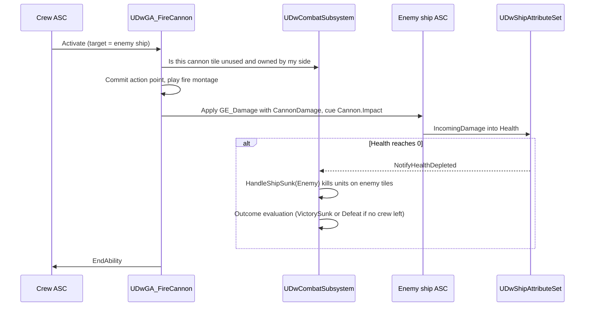

# 06 - Ship and Cannons

## Problem
- Ships have health bars (the hook of the game): player ship 250 HP, two cannons, 70 damage per shot; repair and upgrades at shops.
- Firing a cannon is a crew action; crews can't use the other side's cannons.
- Sinking the enemy ship wins the fight (1x loot) and kills everyone on it - including player boarders. Losing your ship loses the run.

### Decided by Brandon (2026-10-25)
- C7: the crew member must stand on or 4-way next to one of their own ship's cannon tiles; firing uses their action; each cannon fires at most once per side turn; cannons hit the enemy ship only (never crew on deck).
- C8: crew attacks never damage the ship. Ship damage comes only from cannons, explosive barrels and specific abilities whose pattern targets a ship (`EnemyShip`, `SingleUnitOrShip`). Explosive barrels are new and not in `DeadwaterRun.md` or Scope - see Open-Questions C8a before anyone builds them.
- C11/C12: sinking gives no kill XP; if the sinking kills your last crew (or your captain), you lose.

## Decisions
| Option | Verdict |
|---|---|
| **A. `ADwShip` actor with its own ASC + `UDwShipAttributeSet`; cannons are `Tile.Cannon` tiles on the deck layout; firing is `UDwGA_FireCannon` on the crew member** | **Chosen.** One damage pipeline (GE) for ships and units; cannon rules live in tile data + one ability |
| B. Cannons as separate actors with their own abilities | Rejected: extra actors and ownership rules for no gain |
| C. Ship HP as a plain number in the combat subsystem | Rejected: upgrades, repairs, Kraken slams and UI bindings would all need special cases |

## Classes and data

`ADwShip : AActor, IAbilitySystemInterface` (Combat/)
- Components: `UStaticMeshComponent` (Synty ship, set in `BP_Ship_*`), `UDwAbilitySystemComponent`, `UDwShipAttributeSet`.
- `EDwSide Side`, `TObjectPtr<const UDwDeckLayout> Deck`, `TArray<FIntPoint> CannonTiles` (board coordinates after build).
- `InitializeFromState(const FDwShipState&, const FDwShipTuningRow&)` applies `GE_InitShipStats` and upgrade GEs.
- No tick; sinking presentation is a cue (`GameplayCue.Ship.Sink`).

`FDwShipState` (Run/, persists): `Health`, `TArray<FPrimaryAssetId> Upgrades`. `MaxHealth` and `CannonDamage` are base tuning plus upgrade GEs.

`UDwShipUpgradeDefinition : UDwDefinitionBase` (Data/): name, icon, description, `TSubclassOf<UGameplayEffect> Effect` (infinite; e.g. +MaxHealth, +CannonDamage), `FGameplayTagContainer GrantedShipTags` (e.g. `Ship.Upgrade.ExtraCannon` unlocks layout cannon tiles tagged as requiring it), tuning row (price). The list of upgrades is Open-Questions P9.

`DT_ShipTuning` rows: `PlayerShip` (MaxHealth 250, CannonDamage 70), one row per enemy ship.

`UDwGA_FireCannon : UDwGA_EffectPayload` (Abilities/)
- Requires the source unit on or 4-way adjacent to an unused `Tile.Cannon` tile whose `Owner` equals the unit's side - this is "player crew cannot use enemy cannons". Pure helper: `FDwCannonRules::FindUsableCannon(Grid, UnitTile, Side, UsedCannons) -> TOptional<FIntPoint>`; if more than one qualifies it picks the unit's own tile first, then the lowest board index (all cannons on a ship deal the same damage, so the choice never matters to the outcome and the player never has to pick).
- Each cannon tile fires at most once per side turn (tracked by `UDwCombatSubsystem::CannonsUsedThisTurn`, cleared at side-turn start). Costs 1 `ActionPoints`; a unit with no action left can't fire.
- Target pattern `EnemyShip` only (or `Unit.Kraken.Body` in the Kraken fight, pending B4). Damage = firing ship's `CannonDamage` through `GE_Damage`.
- `GatherValidTargets` returns nothing when no usable cannon is in reach, so the action bar shows "Stand next to a cannon" as the disabled reason.
- Cues: `GameplayCue.Cannon.Fire` on the source cannon tile, `GameplayCue.Cannon.Impact` on the target ship.

## Flow

## Repair and upgrades
- Shop repair (100 gold): `FDwShopRules` changes `FDwShipState.Health` by the repair amount from `DT_EconomyTuning` (amount is Open-Questions P7). No GAS involved outside combat - run state is the truth between fights.
- Upgrades: bought at the shop, appended to `FDwShipState.Upgrades`, applied as GEs at every fight spawn.
- Events may damage or repair the ship through `UDwEventOutcome_ShipHealth`.

## Connections
- `02-GAS-Foundation.md`: ship attribute set, `GE_Damage`, `GE_Kill`.
- `03-Combat-Turns.md`: sinking handling and outcome priority.
- `04-Grid-Board.md`: cannon tiles and deck ownership.
- `07-Enemy-AI.md`: enemies fire their own cannons; profile weight decides sink-versus-fight.
- `08-Kraken-Boss.md`: Tentacle Slam can target the ship.
- `10-Economy-Shop-Loot.md`: repair, upgrades, sink 1x loot.
- `14-UI.md`: two ship health bars always visible; cannon-ready indicators on cannon tiles.
- `15-Audio-VFX.md`: fire, impact and sink cues.

## Build order
1. DW-101 (gameplay-engineer): ship attribute set.
2. DW-103: `ADwShip`, spawn, sink handling.
3. DW-104: `UDwGA_FireCannon`, `GA_FireCannon` BP, cannon usage tracking.
4. DW-204: repair and upgrade purchases; DW-304: upgrade content once P9 is answered.

## How it's tested
- Pure: `FDwCannonRules::FindUsableCannon` - on the tile, next to it (4-way), diagonal (rejected), enemy cannon (rejected), used cannon (rejected), two in reach (own tile wins).
- Test world: firing from or next to an own cannon tile damages the enemy ship by `CannonDamage` and spends the action; firing from the enemy's cannon tile is rejected; melee and ranged attacks can't target the ship; the same cannon can't fire twice in one side turn; sinking kills enemy-side units and player boarders standing on enemy tiles and gives no kill XP; player ship at 0 -> `DefeatShipSunk`.
- Pure: repair never exceeds max; upgrade GE stacking.

## What the player sees
- Two ships with big, readable health bars. A pirate walks up to a cannon (each cannon fires once a turn, so two gunners matter), fires, the shot booms across, the enemy hull splinters and the bar drops 70. When the enemy ship goes down, anyone still aboard goes down with it - so boarding is a gamble.
