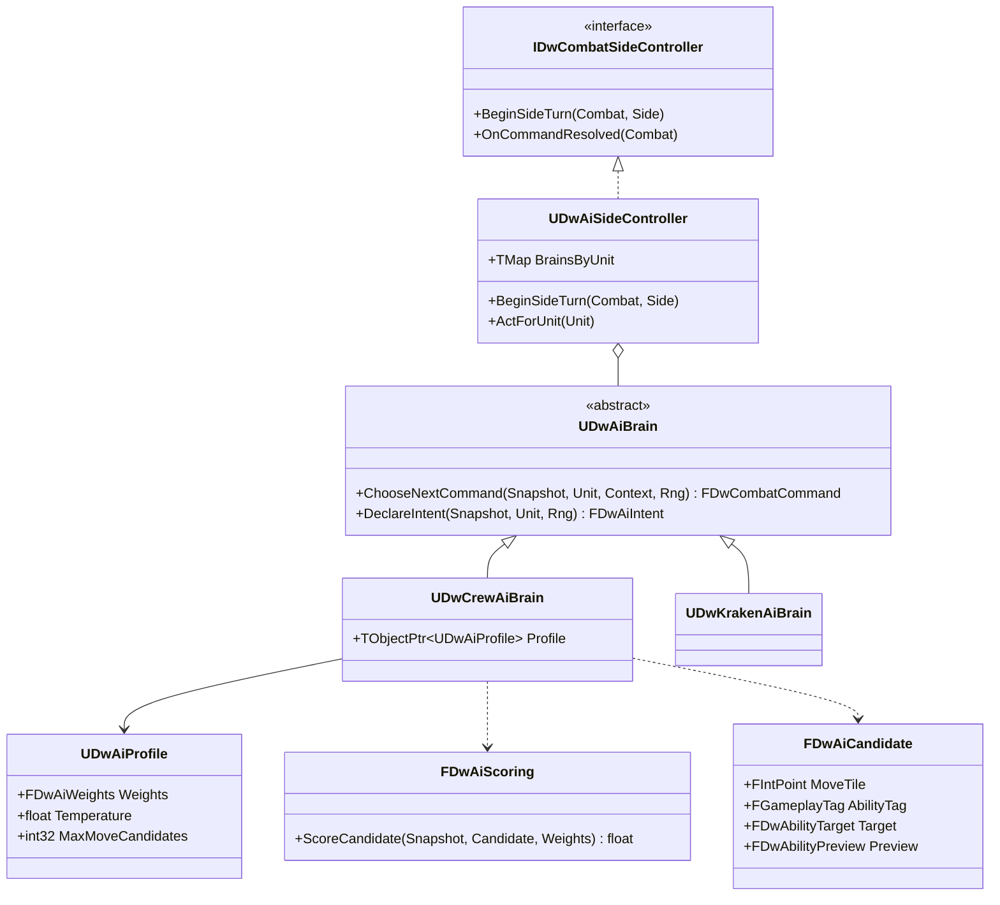

# 07 - Enemy AI (Crews)

Kraken-specific behaviour is in `08-Kraken-Boss.md`; it reuses everything here.

## Problem
- 4-5 rival crews must choose moves, attacks, abilities, cannon shots and targets that a player can understand - medium difficulty (`context/ideal-customer-profile.md`).
- Decisions must be deterministic per seed, testable without a world, and playable by the headless simulator (which also needs a "player policy").
- Enemies act through the same commands, abilities, effects and tags as the player.

## Decision
| Option | Verdict |
|---|---|
| **A. Pure C++ utility planner: enumerate candidate (move tile, ability, target) triples from the snapshot, score with weights from a `UDwAiProfile` DataAsset, pick the best (seeded tie-break / temperature), submit as commands** | **Chosen.** Pure, deterministic, cheap (fewer than 20 units, small boards), tunable by the Balance Designer, reusable as the simulator's player policy |
| B. StateTree (enabled in the template) | Rejected: tick/world-bound, harder to unit-test, poor fit for "pick the best action this turn" |
| C. Behavior Trees + AIController | Rejected: same as B plus pawn possession we don't need |
| D. Look-ahead search (minimax / MCTS) | Rejected: overkill and expensive in GAS; one-ply utility with good heuristics is enough for medium difficulty |

## Classes (AI/, owner ai-engineer)

- `UDwAiSideController : UObject, IDwCombatSideController` - created by the combat subsystem for the enemy side. For each enemy unit the turn manager hands it, it runs the "loop until latent" pattern (`03-Combat-Turns.md`) until the brain returns `EndUnit`.
- `UDwAiBrain` (abstract UObject) - stateless between calls apart from config; `ChooseNextCommand` is `const` in spirit and only reads the snapshot.
- `UDwCrewAiBrain`
  1. Candidate moves: `FDwPathfinder::ComputeReachable` from the unit's tile (if `MovePoints > 0` and not rooted), pruned to the best `MaxMoveCandidates` by a cheap positional score (distance to preferred targets, cannon tiles, cover, nest for ranged units).
  2. For each move tile (plus "stay"), each usable ability (cost affordable, not blocked), each valid target (`UDwGameplayAbility::GatherValidTargets` on the CDO with a hypothetical source tile), compute `PreviewOutcome` (pure, uses `FDwDamageRules`).
  3. Score with `FDwAiScoring` and the profile weights; pick the max; ties and `Temperature` resolved with the combat random stream.
  4. Emit `Move` first (if the tile differs), then the `Ability` command on the next call, then `EndUnit`.
- `FDwAiScoring` (pure) terms: expected unit damage, kill bonus, ship damage (cannons), healing/cleansing value, Fear and status value, danger at the destination (threat from player units next turn), boarding preference, sinking-risk avoidance (don't stand on a ship about to sink), focus on low-Health targets, MP conservation.
- `UDwAiProfile : UDwDefinitionBase` - `FDwAiWeights` (one float per term), `Temperature`, `MaxMoveCandidates`, `bPreferCannons`, `bBoarders`; numbers come from `DT_AiTuning` rows so the Balance Designer tunes them in JSON. Each `UDwEncounterDefinition` (crew) and each enemy slot can reference a profile - this is how 4-5 crews get distinct personalities (e.g. "gunners" vs "boarders"; the actual personalities are Brandon's call, Open-Questions N2).
- `FDwAiIntent` - `AbilityTag`, target, `bTelegraph`. Crews may declare intents (optional); the Kraken always does.

## Rules the AI must respect
- Only actions a player could take; no hidden information beyond what the HUD shows (the AI does not read the combat random stream's future).
- Never target with the other side's cannons (enforced by the ability anyway).
- Frozen/cowering units are skipped by the turn manager before the brain is asked.
- Deterministic: same snapshot + same random stream state = same command.

## Simulator player policy
- `UDwSimPlayerSideController` (tools-engineer) uses `UDwCrewAiBrain` with a player-side `UDwAiProfile` (`DA_AiProfile_SimPlayer`). This reuses the scoring rather than writing a second AI.
- Captain abilities need scoring terms that understand them (Fear value, surrender proximity, guard value, Grapple and Charge positioning) - ai-engineer adds these in DW-214 so the simulator plays all three captains sensibly.

## Connections
- `02-GAS-Foundation.md`: `GatherValidTargets`, `PreviewOutcome`, costs, blocking tags.
- `03-Combat-Turns.md`: side controller contract, commands, random stream.
- `04-Grid-Board.md`: reachability and LOS.
- `05-Crew-Captains.md`: Fear, guard, freeze values.
- `08-Kraken-Boss.md`: `UDwKrakenAiBrain`.
- `13-Data-Layout.md`: `DT_AiTuning`.
- `14-UI.md`: optional intent icons; enemy turn pacing via presentation.
- `17-Testing-Simulator.md`: simulator policy and balance metrics.

## Build order (ai-engineer)
1. DW-106: side controller, crew brain with core terms (damage, kill, ship damage, danger, low-Health focus), `UDwAiProfile`, `DT_AiTuning` row struct.
2. DW-214: captain-ability terms and the simulator player profile.
3. DW-302: Kraken brain.
4. DW-305 support: profiles for each enemy crew once compositions are answered.

## How it's tested (`DeadwaterRun.AI.*`)
- Pure scenarios built from hand-made snapshots: finishes a low-Health target when able; fires a cannon when the player ship is nearly sunk and the profile prefers cannons; doesn't board a ship about to sink; doesn't move into a tile threatened by three player units when an equal option is safe; uses a heal on a wounded ally.
- Determinism: 1,000 seeded calls on the same snapshot give the same command.
- Performance: a full enemy turn plans in under 5 ms on a 12x24 board (simulator budget).
- Simulator: enemy crews each produce a different "where runs die" profile.

## What the player sees
- Enemy pirates who board when you're weak, fire cannons when your hull is low, focus the wounded pirate, and back off from a sniper in the nest - smart enough to be a real fight, readable enough to outplay.
