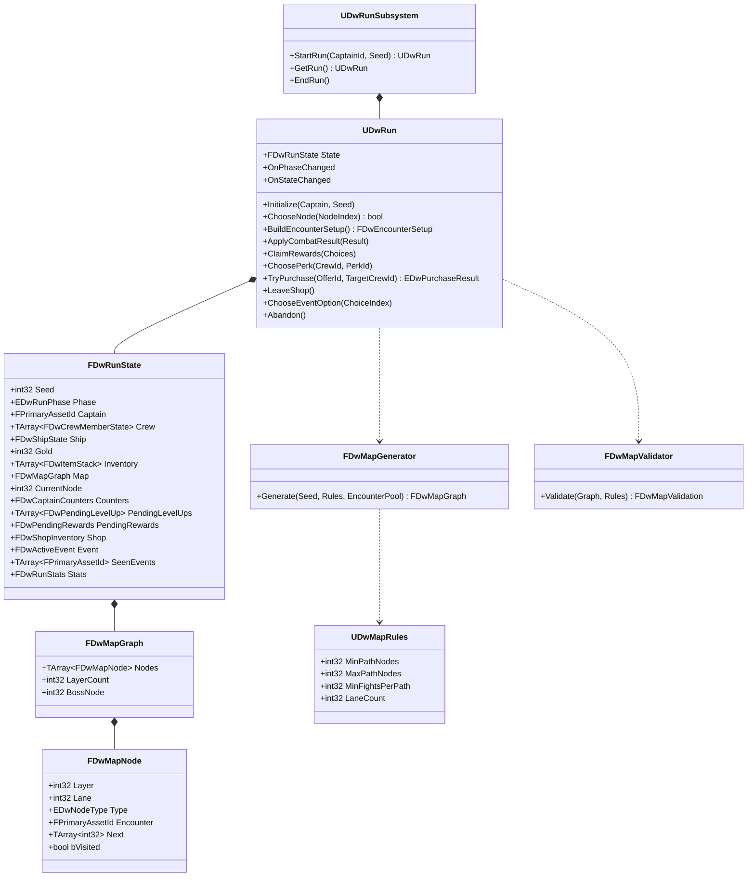

# 09 - Run State, Run Flow and Map Generation

## Problem
- A run: pick a captain, travel 8-9 nodes (fights, shops, events) with 5 fights guaranteed, then the Kraken. No two shops or two events in a row; a shop option before the boss; 2-3 choices to go next; forward only; visited nodes marked complete.
- Run state (crew, ship, gold, items, map, captain counters) must survive level travel, be world-free for the simulator, and be the single truth every screen reads.
- Map generation must be seeded and deterministic and provably follow the rules.
- No mid-run saves (Scope).

## Decisions

### D1 - Run state ownership
| Option | Verdict |
|---|---|
| **A. `FDwRunState` (pure USTRUCT) inside a world-free `UDwRun` UObject (flow + rules calls); `UDwRunSubsystem` (`UGameInstanceSubsystem`) holds the active `UDwRun`** | **Chosen.** Survives travel; the simulator creates `UDwRun` directly without a GameInstance |
| B. Run state on the GameMode/GameState | Rejected: destroyed on travel, needs a world |
| C. Run state in a SaveGame object | Rejected: no mid-run saves; adds serialization we don't need |

### D2 - Map shape
| Option | Verdict |
|---|---|
| **A. Layered lanes: N layers (8 or 9) x `LaneCount` lanes (default 3); each node links to the same and neighbouring lanes in the next layer (2-3 choices); one boss node after the last layer; types assigned with constraints, then validated, retried with a derived seed** | **Chosen.** Slay-the-Spire-like and familiar to the target players, simple to validate with dynamic programming |
| B. Free-form random DAG | Rejected: harder to guarantee 2-3 choices and readability |
| C. Hand-authored maps | Rejected: low replay value |

## Run classes (Run/)

- `UDwRun` is the only writer of `FDwRunState`. Every mutation goes through a named method that calls a pure rule (`FDwRewardRules`, `FDwShopRules`, `FDwEventResolver`, `FDwProgressionRules`, `FDwCaptainRules`), then broadcasts `OnStateChanged` (view models refresh) and, if the phase changed, `OnPhaseChanged`.
- `EDwRunPhase`: `Map`, `Combat`, `Rewards`, `LevelUp`, `Shop`, `Event`, `Victory`, `Defeat`. Captain select and the summary are shell screens outside the run phases (`16-Shell.md`).
- Methods validate the phase (e.g. `TryPurchase` only in `Shop`) and return false; illegal calls log a `LogDwRun` warning ("... refused: ...") and change nothing. (Changed in DW-201 from `ensure`: the simulator and tests probe illegal calls on purpose.)
- `FDwRunStats`: nodes cleared, fights by outcome, gold earned/spent, crew lost (name, node), kills, rounds, captain, seed, elapsed real time (game only), end reason (`Victory`, `ShipSunk`, `CrewDead`, `CaptainDead`, `Abandoned`). Feeds the run summary and the simulator report. The summary screen shows Brandon's U4 list (captain, seed, nodes, fights by outcome, gold, crew lost, kills, time); rounds are for the simulator only. Damage dealt joins when `FDwCombatResult` reports it (DW-212).

### As built in DW-201 (2026-11-10)
- Definitions in run state are object pointers (`TObjectPtr<const UDwUnitDefinition>` etc.), not `FPrimaryAssetId`s, matching `FDwCombatantSetup`: transient test content works, `UDwRun` keeps them referenced, and every definition is resident anyway (`UDwAssetManager`).
- Roster ids are seeded (`FDwRunRandom::ForCrew` + a serial in `FDwRunState::LastCrewSerial`), so a seed reproduces the same ids.
- Until DW-202, `UDwRun::Initialize` builds `FDwPlaceholderMap` (`Run/Map/`): the D2 lane shape with every node a fight, encounters picked by weight and layer tier from `UDwRunSubsystem::GatherEncounterPool` (sorted by name). DW-202 swaps that one call for generate + validate.
- After a won fight the run goes straight back to `Map`; DW-203 inserts `Rewards`/`LevelUp`. `LeaveShop()` / `LeaveEvent()` return a shop or event node to the map; DW-204/DW-205 add the purchases and outcomes before them.
- The boss node's encounter is `DA_GameData.KrakenEncounter`; until DW-209 sets it, `BuildEncounterSetup` reports why the boss fight can't start.
- `ADwGameMode` is the phase bridge: `Combat` -> `BuildEncounterSetup` -> `StartEncounter`; `OnCombatEnded` -> `PostCombatSeconds` beat (next tick in instant mode) -> `EndEncounter` -> `ApplyCombatResult`.
- `ApplyCombatResult` writes survivor Health and permadeath back; there is no Mana in run state (C9: MP refills at every fight start). Any `Defeat*` outcome, including `DefeatCaptainDead` (C10), moves the run to `Defeat`.

### Seeds (`FDwRunRandom`, pure)
- Run seed: random at Set Sail, or from `-DwSeed=`/dev settings.
- Derived streams: `ForMap(Seed, Attempt)`, `ForNode(Seed, NodeIndex)` (combat, shop, event at that node), `ForRewards(Seed, NodeIndex)`. Derivation = `HashCombine` of the seed and a fixed salt per purpose, so choices at one node never shift randomness at another.

### Node entry
| Node | `ChooseNode` does | Next phase |
|---|---|---|
| Fight | Encounter already assigned at generation | `Combat` (game mode starts the encounter) |
| Shop | `FDwShopRules::GenerateInventory(State, ShopDefinition, ForNode)` | `Shop` |
| Event | `FDwEventResolver::Roll(State, ForNode)`: good/bad roll, then an unseen event of that valence | `Event` |
| Boss | Kraken encounter | `Combat` |

- `ChooseNode` only accepts an index in the current node's `Next` list (forward only); the chosen node is marked visited and becomes current. Visited nodes render as complete on the map.

## Map generation (Run/Map/, pure)

`UDwMapRules : UDwDefinitionBase` (Data/, `DA_MapRules`)
| Field | Default (from design) |
|---|---|
| `MinPathNodes`, `MaxPathNodes` | 8, 9 (excluding the boss) |
| `MinFightsPerPath` | 5 (pending M2: "at least" vs "exactly") |
| `LaneCount` | 3 (gives 2-3 choices) |
| `bNoConsecutiveShops`, `bNoConsecutiveEvents` | true, true |
| `bShopOptionBeforeBoss` | true |
| `FirstLayerType` | Fight (pending M3) |
| `TypeWeights` | Fight / Shop / Event weights for unconstrained slots (tuning) |
| `MaxAttempts` | 50 |

`FDwMapGenerator::Generate(Seed, Rules, EncounterPool)`
1. Layer count = 8 or 9 from the seed (M1).
2. Create `LaneCount` nodes per layer; link each node to lanes `j-1, j, j+1` of the next layer when they exist; a virtual start links to every first-layer node; every last-layer node links to the boss.
3. Assign forced slots first: the first layer (`FirstLayerType`) and a shop in the middle lane of the last layer (reachable from every lane of the previous layer). Fill the rest layer by layer by weight, rejecting a type that would make Shop -> Shop or Event -> Event along any edge, in or out (so the layer before the forced shop gets no shops).
4. Assign each fight an encounter from `EncounterPool` filtered by layer tier (`UDwEncounterDefinition::MinLayer/MaxLayer`), avoiding repeats where possible.

`FDwMapValidator::Validate(Graph, Rules)` returns every broken rule (not just the first):
- Every start-to-boss path has length within min/max, and at least `MinFightsPerPath` fights (DP over layers: min and max fights per node).
- No edge Shop -> Shop or Event -> Event.
- Every node has 2-3 outgoing choices (except the last layer -> boss).
- Every node in the second-to-last layer has at least one shop child.
- Every fight has an encounter; the boss exists and is reachable from every node.

`UDwRun::Initialize` calls generate + validate up to `MaxAttempts` with `ForMap(Seed, Attempt)`; the seed sweep test guarantees this never runs out.

## Connections
- `03-Combat-Turns.md`: `BuildEncounterSetup` / `ApplyCombatResult`.
- `05-Crew-Captains.md`: roster and captain counters.
- `10-Economy-Shop-Loot.md`, `11-Events.md`, `12-Progression.md`: pure rules called by `UDwRun`.
- `13-Data-Layout.md`: `DA_MapRules`, encounter pool via the Asset Manager.
- `14-UI.md`: `UDwRunViewModel`, `UDwMapViewModel` read state and call `ChooseNode`.
- `16-Shell.md`: start, abandon, summary, travel.
- `17-Testing-Simulator.md`: simulator drives `UDwRun` directly.
- `Editor-Tools.md`: map preview + rule validator + sweep commandlet.

## Build order (gameplay-engineer)
1. DW-201: `FDwRunState` and friends, `UDwRun`, `UDwRunSubsystem`, phases, `FDwRunRandom`, captain-based run init, `ADwGameMode` phase bridge.
2. DW-202: `UDwMapRules`, generator, validator, encounter assignment; seed sweep test.
3. DW-203/204/205: rewards, shop, events plug into `UDwRun`.
4. tools-engineer DW-213: map preview EUW and `-run=DwMapSweep`.

## How it's tested
- Pure (`DeadwaterRun.Rules.Map.*`): validator catches each broken rule on hand-made graphs; generator output passes the validator for 10,000 seeds (seed sweep) and is identical for identical seeds.
- Pure (`DeadwaterRun.Rules.Run.*`): `ChooseNode` rejects backward/non-adjacent nodes; phase guards; `ApplyCombatResult` writes Health and permadeath; defeat on every `Defeat*` outcome including captain death; the next fight's setup starts every crew member at full Mana.
- Simulator: average run length in nodes is 9-10 including the boss; every run reaches the boss or a defeat.

## What the player sees
- A sea chart with 2-3 routes ahead, icons for fights, shops and events, the path behind marked as sailed, and the Kraken waiting at the end. Every run's chart is different, but always fair: enough fights to grow, a shop before the boss.
