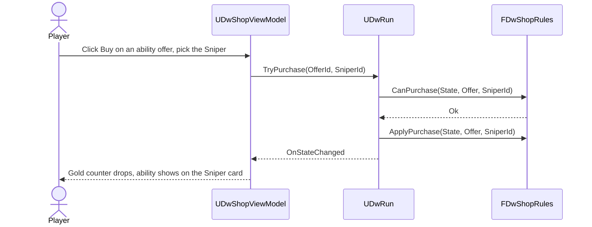

# 10 - Economy, Rewards, Plunder and Shop

## Problem
- Victory pays gold and a new ability: sinking = 1x loot (e.g. 150 gold + a new move); killing the crew and sparing the ship = 1.5x (e.g. 225 gold + a new move); plunder also grants a random item; surrender (Fearmongerer) gets the plunder.
- Shops: repair the ship (100 gold), unlock abilities (50 gold each), buy items (health/mana restore, 30 gold each), disband and recruit crew (max 4), ship upgrades.
- The Balance Designer must tune every price and multiplier from simulations without touching code.

## Decision
| Option | Verdict |
|---|---|
| **A. Pure rule functions (`FDwRewardRules`, `FDwShopRules`) over `FDwRunState` + tuning rows; `UDwRun` is the only caller; content (abilities, items, upgrades, recruits) comes from pools in data** | **Chosen.** Testable, simulator-ready, one place for every number |
| B. Shop as an actor/UI-driven logic | Rejected: UI must never own rules; simulator couldn't shop |
| C. A generic "transaction/effect" framework | Rejected: speculative; the shop has 6 offer types |

## Data
- `DT_EconomyTuning` (row `Default`): `StartingGold`, `SinkLootMultiplier` (1.0), `PlunderLootMultiplier` (1.5), `SurrenderLootMultiplier` (1.5), `PlunderItemChance`, `RepairCost` (100), `RepairAmount` (P7), `AbilityUnlockCost` (50), `ItemCost` (30, or per item from `DT_ItemTuning`), `RecruitCostDefault`, `DisbandRefund`, `MaxCrew` (4), `ShopAbilityOffers`, `ShopRecruitOffers`, `ShopUpgradeOffers`, `RewardAbilityChoices`.
- `DT_EncounterTuning` per encounter: `BaseGold` (e.g. 150), `ClearXp`, `bGrantsAbilityChoice`.
- `UDwShopDefinition : UDwDefinitionBase` (`DA_Shop_Default`): which offer types appear, the item list (`DA_Item_HealthRestore`, `DA_Item_ManaRestore`), the recruit pool (`UDwUnitDefinition` list), the upgrade pool (`UDwShipUpgradeDefinition` list).
- `UDwItemDefinition : UDwDefinitionBase`: name, icon, description, `TSubclassOf<UGameplayEffect> Effect` (e.g. `GE_Heal` with `Data.Heal` from tuning), `FDwTargetingRules` (self/ally, range), tuning row (`Price`, `Amount`, `Range`), `MaxStack`.
- `UDwAbilityPool : UDwDefinitionBase`: weighted list of `UDwAbilityDefinition`; each unit definition points at its learnable pool.

## Rewards (`FDwRewardRules`, Run/Economy/, pure)
- `ComputeRewards(const FDwCombatResult&, const FDwEncounterTuningRow&, const FDwEconomyTuningRow&, FRandomStream&) -> FDwRewardBundle`
  - `Gold = round(BaseGold x Multiplier(Outcome))` where multiplier is sink 1.0 / crew defeated 1.5 / surrender 1.5 / boss 0.
  - Plunder (crew defeated or surrender): roll `PlunderItemChance` for one random item from the shop item list (P6).
  - `AbilityChoices`: `RewardAbilityChoices` abilities drawn from the living crew's learnable pools, filtered by the captain's `AllowedWeaponTags` and abilities already known (P5).
  - XP: see `12-Progression.md`.
- `UDwRun` stores the bundle in `PendingRewards`; `ClaimRewards(Choices)` applies gold, items and the chosen ability (to the chosen crew member) and moves to `LevelUp` or `Map`.

## Shop (`FDwShopRules`, Run/Economy/, pure)
- `GenerateInventory(const FDwRunState&, const UDwShopDefinition&, FRandomStream&) -> FDwShopInventory` - offers with stable `OfferId`s: `Repair`, `Item` x N, `Ability` (ability + eligible crew) x N, `Recruit` (unit def + cost) x N, `ShipUpgrade` x N, `Disband` (per living non-captain crew).
- `CanPurchase(State, Offer, TargetCrew) -> EDwPurchaseResult` (`Ok`, `NotEnoughGold`, `CrewFull`, `AlreadyKnown`, `NoSlot`, `ShipFull`, `InvalidTarget`, `SoldOut`).
- `ApplyPurchase(State&, Offer, TargetCrew)` - deducts gold, mutates state, marks the offer sold out where appropriate.
- Rules enforced: crew never exceeds `MaxCrew`; the captain can't be disbanded; repair never exceeds max ship Health; ability slots per crew member (P4); Conqueror's weapon restriction on captain abilities.
- Recruits are created by `FDwCrewFactory::Create(UnitDefinition, Level, Rng)` (Run/) - the same function the run uses for the starting crew.

## Connections
- `03-Combat-Turns.md`: outcome feeds the multiplier.
- `05-Crew-Captains.md`: recruits use unit definitions; weapon restrictions; surrender plunder.
- `06-Ship-Cannons.md`: repair and upgrades.
- `09-Run-Map.md`: shop node entry and `UDwRun` methods.
- `11-Events.md`: events grant/take gold, items, abilities through the same state methods.
- `12-Progression.md`: ability slots and XP.
- `13-Data-Layout.md`: tuning tables.
- `14-UI.md`: shop, rewards screens; gold counter juice.

## Build order (gameplay-engineer)
1. DW-104: `UDwItemDefinition` + the two items (needed for the item action in combat).
2. DW-203: `FDwRewardRules`, pending rewards, claim flow.
3. DW-204: `UDwShopDefinition`, `FDwShopRules`, `FDwCrewFactory`, `UDwRun::TryPurchase`.
4. DW-304: final ability pools and upgrade content.

## How it's tested (`DeadwaterRun.Rules.Economy.*`, pure)
- Gold: 150 base -> 150 sunk, 225 crew defeated, 225 surrender, 0 boss.
- Plunder item roll stable per seed; never on sink.
- Every `EDwPurchaseResult` reachable and correct; gold never negative; crew max 4; captain never disbanded; repair clamps.
- Simulator report: gold at each shop visit, purchases by type, % of runs that can't afford repair before the boss.

## What the player sees
- After a fight, the gold counter ticks up - more if they spared the ship. At the shop, low hull and 120 gold forces a real choice: repair, or teach the sniper a new trick.
