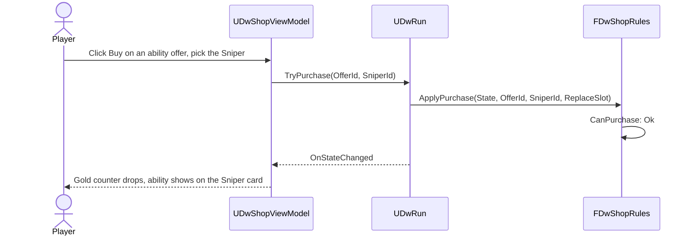

# 10 - Economy, Rewards, Plunder and Shop

## Problem
- Victory pays gold and a new ability: sinking = 1x loot (e.g. 150 gold + a new move); killing the crew and sparing the ship = 1.5x (e.g. 225 gold + a new move); plunder also grants a random item; surrender (Fearmongerer) gets the plunder.
- Shops: repair the ship (100 gold), unlock abilities (50 gold each), buy items (health/mana restore, 30 gold each), disband and recruit crew (max 4), ship upgrades.
- The Balance Designer must tune every price and multiplier from simulations without touching code.

## Decision
| Option | Verdict |
|---|---|
| **A. Pure rule functions (`FDwRewardRules`, `FDwShopRules`) over `FDwRunState` + tuning rows; `UDwRun` is the only caller; content (abilities, items, upgrades, recruits) comes from pools in data** | **Chosen.** Testable, simulator-ready, one place for every number |
| B. Shop as an actor/UI-driven logic | Rejected: UI must never own rules; simulator couldn't shop |
| C. A generic "transaction/effect" framework | Rejected: speculative; the shop has 6 offer types |

## Data
- **Every price has exactly one home** (Brandon, 2026-11-11): the offered thing's own tuning row. Item: `DT_ItemTuning.Price` (30). Ability: `DT_AbilityTuning.ShopPrice` (50 on every learnable ability). Recruit: `DT_UnitTuning.RecruitCost` (80, P8). Ship upgrade: `DT_ShipUpgradeTuning.Price`. Repair has no row of its own, so its price is `DT_EconomyTuning.RepairCost` (100). The economy table no longer has `AbilityUnlockCost`, `ItemCost` or `RecruitCostDefault`.
- `DT_EconomyTuning` (row `Default`): `StartingGold`, `SinkLootMultiplier` (1.0), `PlunderLootMultiplier` (1.5), `SurrenderLootMultiplier` (1.5), `PlunderItemChance`, `RepairCost` (100), `RepairAmount` (100, P7), `DisbandRefund` (0, P8), `MaxCrew` (4, living crew including the captain), `RecruitLevelOffset` (-1, P8), `MaxInventory` (6 items in total, P10), `ShopAbilityOffers`, `ShopRecruitOffers`, `ShopUpgradeOffers`, `RewardAbilityChoices`.
- `DT_ShipUpgradeTuning` per upgrade (`FDwShipUpgradeTuningRow`): `Price`, `MaxHealthBonus`, `CannonDamageBonus` (P9: +50 / +20 / third cannon).
- `DT_EncounterTuning` per encounter: `BaseGold` (e.g. 150), `ClearXp`, `bGrantsAbilityChoice`.
- `UDwShopDefinition : UDwDefinitionBase` (`DA_Shop_Default`): which offer types appear, the item list (`DA_Item_HealthRestore`, `DA_Item_ManaRestore`), the recruit pool (`DA_Unit_Swordsman`, `DA_Unit_Sniper`), the upgrade pool (`DA_ShipUpgrade_ReinforcedHull`, `_HeavyShot`, `_ExtraCannon`). Data validation fails if anything in it, or any ability in a `UDwAbilityPool`, has no price above 0 on its row.
- `UDwItemDefinition : UDwDefinitionBase`: name, icon, description, `TSubclassOf<UGameplayEffect> Effect` (e.g. `GE_Heal` with `Data.Heal` from tuning), `FDwTargetingRules` (self or an adjacent ally, P10), tuning row (`Price`, `Amount` +40 HP / +10 MP, `Range`). Items are combat-only (C9a). `MaxStack` is not used: the cap is `MaxInventory`, all kinds together.
- `UDwAbilityPool : UDwDefinitionBase`: weighted list of `UDwAbilityDefinition`; each unit definition points at its learnable pool.

## Rewards (`FDwRewardRules`, Run/Economy/, pure)
Built in DW-203 (`Source/DeadwaterRun/Run/Economy/DwRewardRules.h`).
- `ComputeRewards(const FDwRewardContext&, FRandomStream&) -> FDwRewardBundle`. The context holds the outcome, the node's `FDwEncounterTuningRow`, `FDwEconomyTuningRow`, the run state and the plunder item list (`DA_GameData.DefaultShop->Items`). The stream is `FDwRunRandom::ForRewards(Seed, Node)`.
  - `Gold = round(BaseGold x Multiplier(Outcome))` where multiplier is sink 1.0 / crew defeated 1.5 / surrender 1.5 / boss 0.
  - Plunder (crew defeated or surrender): roll `PlunderItemChance` for one random item from the shop item list. P6 answered: always one item (`PlunderItemChance` 1.0).
  - `AbilityChoices` (`FDwAbilityOffer`: ability + `EligibleCrew`): `RewardAbilityChoices` abilities, weighted and without repeats, drawn from the living crew's learnable pools. A crew member is eligible if the ability is in their pool, they don't know it yet (P5), and, for the captain, it has none of the captain's `BlockedAbilityTags` (Conqueror: no `Ability.Weapon.Firearm`, K2). `DT_EncounterTuning.bGrantsAbilityChoice` turns it off per encounter. Until the crew abilities exist (N1), the pools are empty and no choice is offered.
  - XP: see `12-Progression.md`. The bundle lists each living crew member's XP gain for the rewards screen.
  - Plunder respects `MaxInventory` (P10): with the inventory full, the rolled item goes to `ItemsNoRoom` instead of `Items` (the roll still happens, so the ability draw never shifts). The rewards screen can show it as left behind; it is never added, and `Stats.ItemsLeftBehind` counts it.
- `UDwRun::ApplyCombatResult` stores the bundle in `PendingRewards` (phase `Rewards`). `ClaimRewards(AbilityChoice, CrewId, ReplaceSlot)` banks gold (`Stats.GoldEarned`) and items (one stack per item, up to `MaxInventory` in total) and teaches the chosen ability. `INDEX_NONE` skips the ability. With `MaxAbilitySlots` (P4 placeholder 3) learned already, `ReplaceSlot` names the ability it replaces. Then `LevelUp` or `Map`.

## Shop (`FDwShopRules`, Run/Economy/, pure)
Built in DW-204 (`Source/DeadwaterRun/Run/Economy/DwShopRules.h`). Works on `FDwRunState::Shop` (`FDwShopInventory`); `FDwShopContext` carries the economy row and `MaxAbilitySlots`.
- `GenerateInventory(State, ShopDefinition, Context, Random) -> FDwShopInventory` - offers (`FDwShopOffer`) with stable `OfferId`s (index in `Offers`), in this order: `Repair` (price `RepairCost`, `Amount` = `RepairAmount`), every `Item` of the shop, `ShopAbilityOffers` x `Ability` (weighted from the living crew's pools with `EligibleCrew`, the same draw as rewards), `ShopRecruitOffers` x `Recruit` (unit + the `Level` they'd join at), `ShopUpgradeOffers` x `ShipUpgrade` the ship lacks (recruits and upgrades drawn without repeats), then a `Disband` per living crew member beside the captain. Offer types missing from `OfferTypes` and anything without a price above 0 are left out. `UDwRun` rolls it on arrival with `FDwRunRandom::ForNode(Seed, Node)` and clears it on `LeaveShop`.
- `CanPurchase(State, OfferId, TargetCrew, ReplaceSlot, Context) -> EDwPurchaseResult`, checked in this order: `NoOffer` (no shop open / no such offer), `SoldOut`, then the target (`InvalidTarget`, `AlreadyKnown`, `NoSlot`, `CantDisband`), then room (`CrewFull`, `ShipFull`, `InventoryFull`), then `NotEnoughGold`; else `Ok`. `TargetCrew` is the learner of an ability offer; `ReplaceSlot` names the ability to forget once they know `MaxAbilitySlots` (P4).
- `ApplyPurchase(State&, OfferId, TargetCrew, ReplaceSlot, Context)` - `CanPurchase`, then only if `Ok`: takes the gold (`Stats.GoldSpent`, `Stats.Purchases` by type) and applies the offer; ability, recruit, upgrade and disband offers sell out, repair and items can be bought again. `Refresh` then keeps the rest current (eligible learners, recruit level, a disband offer for a new recruit).
- Rules enforced: gold never goes negative; living crew never exceeds `MaxCrew` (the captain counts); the captain and the last crew member beside him can't be disbanded; disbanded crew leave the roster (no refund: `DisbandRefund` 0); repair adds `RepairAmount` and never exceeds max hull (full price even when less is missing); `MaxInventory` items in total; ability slots (P4) and the captain's `BlockedAbilityTags` (K2); each ship upgrade at most once per run.
- Recruits join at `max(1, floor(average level of the living crew, captain included) + RecruitLevelOffset)` with full Health, no XP and nothing learned (P8).
- Ship upgrades (`06`): `MaxHealthBonus` raises max and current hull, `CannonDamageBonus` raises cannon damage, `GrantedShipTags` unlock deck tiles (`Ship.Upgrade.ExtraCannon` -> the third cannon).
- Items are combat-only (C9a): the shop sells them, the fight uses them.
- Recruits are created by `FDwCrewFactory::Create(State, UnitDefinition, Level, bIsCaptain)` (Run/) - the same function the run uses for the starting crew. Roster ids are seeded (`FDwCrewFactory::MakeId`), so there is no random stream.

### The shop screen's read model (for `UDwShopViewModel`, ui-engineer)
- `UDwRun::GetShop() -> const FDwShopInventory&`: one card per `FDwShopOffer` - `Type`, `Price`, `Amount`, `Item` / `Ability` (+ `EligibleCrew`) / `Unit` + `Level` / `Upgrade` (`GetFormattedDescription`) / `CrewId`, `bSoldOut`.
- `UDwRun::CanPurchase(OfferId, CrewId, ReplaceSlot) -> EDwPurchaseResult` (BlueprintPure, never logs): the enabled state and disabled reason. `UDwRun::TryPurchase(...)` sends the intent; anything but `Ok` is a logged refusal that changes nothing.
- Refresh on `UDwRun::OnStateChanged` (one broadcast per purchase). Gold, hull, crew and inventory come from `GetState()`; `GetMaxInventory()` for "3 / 6".

## Connections
- `03-Combat-Turns.md`: outcome feeds the multiplier.
- `05-Crew-Captains.md`: recruits use unit definitions; weapon restrictions; surrender plunder.
- `06-Ship-Cannons.md`: repair and upgrades.
- `09-Run-Map.md`: shop node entry and `UDwRun` methods.
- `11-Events.md`: events grant/take gold, items, abilities through the same state methods.
- `12-Progression.md`: ability slots and XP.
- `13-Data-Layout.md`: tuning tables.
- `14-UI.md`: shop, rewards screens; gold counter juice.

## Build order (gameplay-engineer)
1. DW-104: `UDwItemDefinition` + the two items (needed for the item action in combat).
2. DW-203: `FDwRewardRules`, pending rewards, claim flow.
3. DW-204: `UDwShopDefinition`, `FDwShopRules`, `FDwCrewFactory`, `UDwRun::TryPurchase`.
4. DW-304: final ability pools and upgrade content.

## How it's tested (`DeadwaterRun.Rules.Economy.*`, pure)
- Gold: 150 base -> 150 sunk, 225 crew defeated, 225 surrender, 0 boss.
- Plunder item roll stable per seed; never on sink; chance 0.5 drops about half the time.
- Ability choices: count, no repeats, weights, eligibility (pool, already known, dead crew, captain blocked tags), off per encounter and for the boss.
- Suites: `DeadwaterRun.Rules.Economy` (pure), `DeadwaterRun.Rules.Run` "Rewards (DW-203)" (flow, claims, slot replacement, refusals), `DeadwaterRun.Run.Content` (real plunder).
- Every `EDwPurchaseResult` reachable and correct; gold never negative; crew max 4; captain never disbanded; repair clamps. Suites: `DeadwaterRun.Rules.Shop` (pure), `DeadwaterRun.Rules.Run` "Shop (DW-204)" (flow, broadcasts, refusals, full inventory leaves plunder behind, a 100-seed sweep: every chart has a shop before the boss and every shop replays identically), `DeadwaterRun.Run.Content` (the real shop; the recruit and third cannon in the next fight). Proof: `Tools/Capture.ps1 -Demo shop`.
- Simulator report: gold at each shop visit, purchases by type, % of runs that can't afford repair before the boss.

## What the player sees
- After a fight, the gold counter ticks up - more if they spared the ship. At the shop, low hull and 120 gold forces a real choice: repair, or teach the sniper a new trick.
