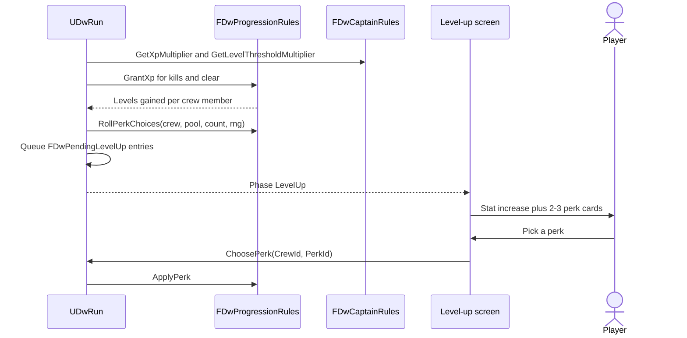

# 12 - Progression: XP, Levels and Perks

## Problem
- Killing an enemy grants XP to the crew member who killed it; clearing an encounter grants XP to every crew member. Crew level up about once per encounter.
- Fixed decision: level-up = a stat increase plus a pick of 1 from 2-3 perks, from data-driven perk pools.
- Veteran Crew (Team Leader): +50% XP and levels up twice as fast (wording to confirm, Open-Questions K7).
- Crew also gain abilities (shop, loot, events) - see `10-Economy-Shop-Loot.md`.

## Decision
| Option | Verdict |
|---|---|
| **A. Pure `FDwProgressionRules` over `FDwCrewMemberState`; XP thresholds and per-level stat gains in tuning tables; perks are `UDwPerkDefinition` assets in `UDwPerkPool` assets; a perk's effect is an infinite GE (or a granted ability) applied at every fight spawn** | **Chosen.** Perks reuse GAS; no perk-specific code; pools are visible assets Brandon edits |
| B. Perks as code classes with hooks | Rejected: code per perk |
| C. Perks as stat-only numbers in a table | Rejected: can't express "grants an ability" or tag-based perks |

## Data
- `DT_ProgressionTuning`: one row per level - `XpToNext`, plus `MaxLevel` in `DT_RunTuning` (P1).
- Per-archetype stat gains live in `DT_UnitTuning` (`HealthPerLevel`, `ManaPerLevel`, `AttackPerLevel`, `MoveRangeAtLevel` if any) - "a stat increase" is automatic and shown on the level-up screen (P2).
- XP sources: `DT_UnitTuning.XpOnKill` (victim), `DT_EncounterTuning.ClearXp`.
- `UDwPerkDefinition : UDwDefinitionBase`: `FText Name`, `FText Description` (with `{Value}` tokens filled from tuning), icon, `TSubclassOf<UGameplayEffect> Effect` (infinite, asset tag `Effect.Perk`), optional `TObjectPtr<UDwAbilityDefinition> GrantedAbility`, `FGameplayTagContainer RequiredUnitTags`, `int32 MaxStacks`, `float Weight`, tuning row (`DT_PerkTuning`: `Value`, `Value2`).
- `UDwPerkPool : UDwDefinitionBase`: `TArray<TObjectPtr<UDwPerkDefinition>> Perks`; each unit definition references one pool (shared or per archetype - P2). `DT_RunTuning.PerkChoices` = 2 or 3.

## Rules (`FDwProgressionRules`, Run/, pure)
Built in DW-203 (`Source/DeadwaterRun/Run/DwProgressionRules.h`, `DwCaptainRules.h`).
- `DT_ProgressionTuning` rows are named by level (`"1"`, `"2"`, ...): `XpToNext` = XP to go from that level to the next. `FDwCrewMemberState::Xp` is the progress inside the current level.
- `GrantXp(Crew&, Amount, XpMultiplier, ThresholdMultiplier, Table, MaxLevel) -> int32 LevelsGained` - `Xp += round(Amount x XpMultiplier)`; level while `Xp >= round(XpToNext(Level) x ThresholdMultiplier)`; cap at `MaxLevel` (or the table's last row). XP is reset to 0 at the last level. Dead crew gain nothing.
- `RollPerkChoices(Crew, Pool, Count, Rng) -> TArray<const UDwPerkDefinition*>` - weighted, filters `RequiredUnitTags` and `MaxStacks`, no duplicates in one offer.
- `ApplyPerk(Crew&, Perk)` - appends to `Crew.Perks` (and `Abilities` for a granted ability, once); refuses beyond `MaxStacks`.
- `GetLevelStats(UnitTuning, Level) -> FDwLevelStats` - base + gains x (Level - 1), the same `FDwUnitTuningRow::Get*AtLevel` numbers combat spawns with; used for the level-up's stat gain. When `MaxHealth` grows, current `Health` grows by the same amount.
- Multipliers come from `FDwCaptainRules::GetXpMultiplier` and `GetLevelThresholdMultiplier`. Only a captain with `Rule.Captain.VeteranCrew` gets them; every other captain gets 1. K7 answered: +50% XP only (`LevelThresholdMultiplier` 1.0).
- Perk effects: each `GE_Perk_*` is a Blueprint child of `UDwGE_Perk` (infinite, asset tag `Effect.Perk`) with modifiers that read SetByCaller `Data.Value`. The spawn (`UDwCombatSubsystem`) applies every perk in `FDwCombatantSetup::Perks` with `Data.Value` = the perk's `DT_PerkTuning.Value`. `UDwPerkDefinition::GetFormattedDescription` fills `{Value}`, `{ValuePct}`, `{Value2}` and `{Value2Pct}`.

## Flow
- During combat: kills are recorded in `FDwCombatResult` (killer roster id -> victim XP); no mid-fight level-ups (recommended, P3). Kill credit rules (C11, decided): a damage-over-time kill credits the GE's instigator (the caster); units killed by a ship sinking give no kill XP to anyone.
- Combat writes the victim's `DT_UnitTuning.XpOnKill` into each `FDwKillRecord::Xp`, so the run needs no asset lookup.
- After victory (`UDwRun::ApplyCombatResult`): kill XP to each living killer (enemy victims only), clear XP to every living crew member. Each level gained pushes an `FDwPendingLevelUp` (crew id, new level, stat gain, `Ordinal`), in roster order.
- Perk choices are rolled when a level-up reaches the front of the queue, from `FDwRunRandom::ForPerks(Seed, Node, Ordinal)`. That keeps them stable per seed, and an earlier pick's stacks count (two levels in one fight never offer a 1-stack perk twice). The first is rolled right away so the rewards screen can preview it.
- `Rewards` -> `ClaimRewards` -> `LevelUp` screens, one per pending level-up -> `ChoosePerk(ChoiceIndex)` (`INDEX_NONE` when the pool has nothing left to offer) -> next or `Map`.
- Events that grant XP use the same path.

## Connections
- `02-GAS-Foundation.md`: perk GEs, `GE_InitUnitStats`.
- `03-Combat-Turns.md`: kill credit in the result.
- `05-Crew-Captains.md`: Veteran Crew multipliers, Conqueror kill bonus is separate (a captain counter, not a perk).
- `09-Run-Map.md`, `11-Events.md`: phases and XP outcomes.
- `14-UI.md`: `UDwLevelUpViewModel`, XP bars on crew cards.
- `17-Testing-Simulator.md`: "levels per encounter" metric (target ~1).

## Build order (gameplay-engineer)
1. DW-203: tables, rules, pending level-ups, `ChoosePerk`, 3 placeholder perks in one pool.
2. DW-304: final perk pools once Brandon answers P2.
3. balance-designer DW-401: XP curve so the simulator shows ~1 level per encounter.

## How it's tested (`DeadwaterRun.Rules.Progression.*`, pure)
- XP exactly at threshold levels up; multi-level gains queue multiple level-ups; max level caps.
- Veteran Crew multipliers change levels as configured (both readings of K7 covered by table tests).
- Perk rolls: correct count, no duplicates, respect tags and stacks, stable per seed.
- Suites: `DeadwaterRun.Rules.Progression` (pure), `DeadwaterRun.Rules.Run` "XP and level-ups (DW-203)" (kill/clear XP, queue order, refusals, seeds), `DeadwaterRun.Run.Content` (real perks valid; Sea Legs and Hardened change the next fight).
- Simulator: mean levels per encounter per captain.

## DW-203 placeholders
- One shared pool `DA_PerkPool_Shared` (P2 still open): Sea Legs (+1 move, 1 stack), Hardened (-10% damage taken, 2 stacks), Cutthroat (+10% damage, 2 stacks). 3 choices per level-up. Final pools: DW-304.
- XP curve, kill and clear XP, `MaxLevel` 10, `HealthPerLevel` 10: `Docs/Balance/Placeholders.md`.

## What the player sees
- After a fight the crew's XP bars fill; the sniper levels up, gains +HP, and the player picks one of three perk cards - the crew they lose in the next fight is a crew they built.
