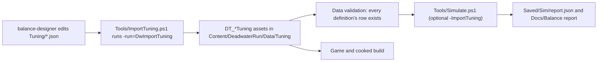

# 13 - Data Layout: DataAssets, DataTables and JSON

## Problem
- "Logic in C++, tuning in data": every number lives in data.
- The Balance Designer's output is "Updated JSONs" - it can't hand-edit binary `.uasset` files, and diffs must be reviewable in a PR.
- Brandon must add content (abilities, items, perks, crews, events, captains) in the editor with dropdowns and validation.
- The simulator and tests must read the same data the game ships.

## Decision
| Option | Pros | Cons | Verdict |
|---|---|---|---|
| A. DataAssets for everything | Great editor UX, typed references | Binary, no JSON workflow, numbers scattered across assets | Rejected alone |
| B. Runtime-loaded JSON files | Text-diffable | Bypasses cooking and validation, loose files in the package, no asset references | Rejected |
| **C. Hybrid: definitions (structure, references, text) are `UPrimaryDataAsset`s; numbers are DataTables whose source of truth is `Tuning/*.json`, reimported by a commandlet** | Brandon edits structure in the editor, agents edit numbers in JSON, both cook normally | Two places to look (mitigated: every definition links its tuning row) | **Chosen** |

Rule of thumb
- If it's a **number a balance pass would change** -> tuning row (JSON).
- If it's **what something is or does** (pattern, effect class, tags, text, mesh, pool membership) -> definition DataAsset.
- Exceptions (numbers kept in assets): event outcome amounts and per-GE fixed modifiers that are not balance targets. Balance Designer changes those through MCP and lists them in the report.

## Definitions (Asset Manager primary assets)

All derive from `UDwDefinitionBase : UPrimaryDataAsset` (Core/), which provides `GetPrimaryAssetId()` (type from the class, name from the asset), `FText DisplayName`, `FText Description`, a `FDataTableRowHandle Tuning` where relevant, and `IsDataValid` (base checks: tuning row exists, display name set).

| Primary asset type | Class | Folder (`/Game/DeadwaterRun/Data/`) |
|---|---|---|
| `DwCaptain` | `UDwCaptainDefinition` | `Captains/` |
| `DwUnit` | `UDwUnitDefinition` | `Units/` |
| `DwAbility` | `UDwAbilityDefinition` | `Abilities/` |
| `DwAbilityPool` | `UDwAbilityPool` | `Abilities/Pools/` |
| `DwItem` | `UDwItemDefinition` | `Items/` |
| `DwPerk`, `DwPerkPool` | `UDwPerkDefinition`, `UDwPerkPool` | `Perks/` |
| `DwEncounter` | `UDwEncounterDefinition` | `Encounters/` |
| `DwKraken` | `UDwKrakenDefinition` | `Kraken/` |
| `DwEvent` | `UDwEventDefinition` | `Events/` |
| `DwShipUpgrade` | `UDwShipUpgradeDefinition` | `Ship/` |
| `DwDeckLayout` | `UDwDeckLayout` | `Boards/` |
| `DwAiProfile` | `UDwAiProfile` | `AI/` |
| `DwRules` | `UDwMapRules`, `UDwShopDefinition` | `Rules/` |
| `DwGameData` | `UDwGameData` | `DA_GameData` at `Data/` root |

- Registered in `Config/DefaultGame.ini` under `[/Script/Engine.AssetManagerSettings]` with `bIsEditorOnly=False` and `CookRule=AlwaysCook`.
- `UDwAssetManager : UAssetManager` (Core/) - `Get()`, `GetGameData()`, `GetDefinitions<T>(Type)`. At startup it synchronously loads all definitions (the whole data set is small); meshes, textures and sounds inside them are soft references loaded on demand.
- Adding content = creating an asset in the right folder. Pools that are "all X" are queries; explicit pools are assets.

### `UDwAbilityDefinition` (the entry point for an ability)
- `FText DisplayName`, `FText Description` (with `{Damage}`, `{Heal}`, `{Range}` tokens filled from tuning), icon.
- `TSubclassOf<UDwGameplayAbility> AbilityClass` (a `GA_*` Blueprint subclass).
- `FGameplayTag AbilityTag` (unique, used in commands), `FGameplayTagContainer AbilityTags` (weapon tags, categories).
- `FDataTableRowHandle Tuning` -> `DT_AbilityTuning`.
- `FDwAbilityAiHints` (expected-value hints for the AI when previews can't capture the value, e.g. guard).

### `UDwEncounterDefinition`
- `EDwEncounterKind Kind` (`ShipBattle`, `Kraken`), display name, `MinLayer`, `MaxLayer`, `Weight`.
- Ship battle: `TObjectPtr<UDwDeckLayout> ShipDeck`, `TSoftClassPtr<ADwShip> ShipClass`, ship tuning row, `TArray<FDwEnemySlot> Units` (unit definition, level, AI profile override), `TObjectPtr<UDwAiProfile> AiProfile`.
- Kraken: `TObjectPtr<UDwKrakenDefinition> Kraken`.
- Tuning row -> `DT_EncounterTuning` (gold, clear XP).
- An "enemy crew" in Scope terms = one ship-battle encounter definition.

### `UDwGameData` (singleton DataAsset)
- Shared GE classes (`GE_Damage`, `GE_Heal`, ...), default player deck, player ship class, `DA_MapRules`, `DA_Shop_Default`, the Kraken encounter, captains in display order, tuning table references, `UDwAudioCueMap`, `UDwMusicSet`, `UDwUIScreenSet`, default `TileSize`, levels (`L_MainMenu`, `L_Sea`).

## Tuning tables

| DataTable | Row struct (Data/Tuning/) | Key | Main fields |
|---|---|---|---|
| `DT_UnitTuning` | `FDwUnitTuningRow` | unit id | MaxHealth, MaxMana, AttackDamage, MoveRange, MaxActionPoints, per-level gains, XpOnKill, RecruitCost |
| `DT_AbilityTuning` | `FDwAbilityTuningRow` | ability id | ManaCost, Damage, DamageScale, Heal, Fear, Range, MinHits, MaxHits, DurationTurns, ShopPrice |
| `DT_ItemTuning` | `FDwItemTuningRow` | item id | Price, Amount, Range |
| `DT_PerkTuning` | `FDwPerkTuningRow` | perk id | Value, Value2 |
| `DT_CaptainTuning` | `FDwCaptainTuningRow` | captain id | XpMultiplier, LevelThresholdMultiplier, FearPerSurrender, StartingFearCap, KillBonusPerKill, KillBonusCap, SynergyDamageMultiplier |
| `DT_ShipTuning` | `FDwShipTuningRow` | ship id | MaxHealth, CannonDamage |
| `DT_EncounterTuning` | `FDwEncounterTuningRow` | encounter id | BaseGold, ClearXp |
| `DT_EconomyTuning` | `FDwEconomyTuningRow` | `Default` | Starting gold, multipliers, prices, shop counts, MaxCrew |
| `DT_ProgressionTuning` | `FDwProgressionTuningRow` | level | XpToNext |
| `DT_RunTuning` | `FDwRunTuningRow` | `Default` | GoodEventChance, PerkChoices, MaxLevel, MaxAbilitySlots, bRefillManaOnFightStart, ManaRegenPerTurn |
| `DT_CombatTuning` | `FDwCombatTuningRow` | `Default` | Grid rules (`04`), MaxFear, FearCowerPolicy, outcome toggles |
| `DT_KrakenTuning` | `FDwKrakenTuningRow` | Kraken id | TentacleCount, TentacleHealth, actions per phase, tentacle scaling |
| `DT_AiTuning` | `FDwAiTuningRow` (owner ai-engineer) | profile id | Weights, Temperature, MaxMoveCandidates |

### JSON source format (`Tuning/<Table>.json`, Unreal's DataTable JSON format)
```json
[
  { "Name": "Swordsman", "MaxHealth": 100, "MaxMana": 20, "MoveRange": 5, "MaxActionPoints": 1 },
  { "Name": "Sniper",    "MaxHealth": 100, "MaxMana": 20, "MoveRange": 5, "MaxActionPoints": 1 }
]
```
- Field names = row struct property names. Unknown or missing fields fail the import (the commandlet checks strictly, not Unreal's lenient default).
- Values not in `DeadwaterRun.md` start as placeholders and are listed in `Docs/Balance/Placeholders.md` by the Balance Designer (DW-112).

### Pipeline

- JSON and the imported DataTable are committed together; data validation fails if a DataTable is older than its JSON (import timestamp stored in the asset's import data).

## Ownership
| What | Owner |
|---|---|
| Definition classes, row structs, `UDwGameData`, Asset Manager config (data layout) | gameplay-engineer (AI rows: ai-engineer) |
| Definition assets for content | gameplay-engineer (Brandon can add any time) |
| Values in `Tuning/*.json` and the imported tables | balance-designer |
| Import commandlet, validators | tools-engineer |

## Connections
- Every system reads definitions through `UDwAssetManager` and numbers through the tuning row on the definition - no system keeps its own constants.
- `17-Testing-Simulator.md`: tests use the real tables; a few tests build inline rows for edge cases.
- `Editor-Tools.md`: content wizard creates the asset and its JSON row together.

## Build order
1. DW-004 (gameplay-engineer): `UDwDefinitionBase`, `UDwAssetManager`, `UDwGameData`, Asset Manager config, all row structs with the numbers from `DeadwaterRun.md`, empty JSON files.
2. DW-109 (tools-engineer): `-run=DwImportTuning`, `Tools/ImportTuning.ps1`, toolbar button.
3. DW-112 (balance-designer): fill JSON with design numbers + placeholders list.
4. DW-108 (tools-engineer): validator checks row links and JSON/DataTable sync.

## How it's tested
- `DeadwaterRun.Data.AllDefinitionsValid` runs `IsDataValid` on every primary asset.
- Import commandlet tests: unknown field fails, missing row fails, round trip (export -> import) is lossless.
- `Tools/Validate.ps1` (data validation commandlet) runs before every PR.

## What the player sees
- Nothing directly - but every price, HP and damage number they see was tuned from thousands of simulated runs, and every tooltip number matches the game because both come from the same row.
