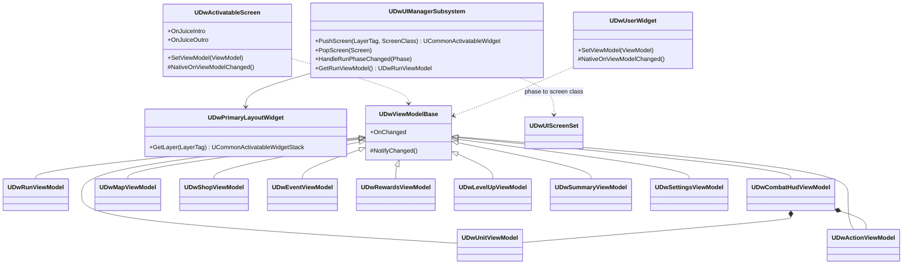

# 14 - UI Architecture

## Problem
- Screens: main menu, captain select, settings, pause, map, combat HUD (with targeting and previews), rewards, level-up, shop, event, run summary, Kraken HUD.
- UI must never own rules (ui-engineer rule), must read the real game state, and must leave clean hooks for the UI Juice Engineer.
- Mouse and keyboard only; readable at 1080p and 1440p.
- Agents build widgets through MCP: binding must be simple to build and review.

## Decisions

### D1 - Screen management
| Option | Verdict |
|---|---|
| **A. CommonUI: one `UDwPrimaryLayoutWidget` with four `UCommonActivatableWidgetStack` layers (`UI.Layer.Game`, `GameMenu`, `Menu`, `Modal`); screens are `UCommonActivatableWidget`s** | **Chosen.** Epic's menu framework: back/escape handling, input mode per screen, focus, pause menus for free |
| B. Hand-rolled screen stack with `AddToViewport` | Rejected: re-implements input routing and back handling |
| C. One giant HUD widget with visibility toggles | Rejected: unscalable, input bugs |

### D2 - Data binding
| Option | Verdict |
|---|---|
| **A. Plain C++ view models (`UDwViewModelBase : UObject`) that subscribe to game delegates and expose getters + an `OnChanged` delegate; C++ widget bases (`BindWidget`) refresh in `NativeOnChanged`** | **Chosen.** Explicit, debuggable, easy for agents via MCP (no editor binding graphs), testable without widgets |
| B. UE MVVM plugin (`UMVVMViewModelBase`, View Bindings) | Rejected for v1: bindings live in the widget editor (hard to build and review through MCP); plugin maturity risk late in the schedule |
| C. Widgets read GAS/run state directly in Blueprint | Rejected: logic in Blueprint, rule leaks, tick-polling |

## Classes (UI/, owner ui-engineer)

- `UDwUIManagerSubsystem : ULocalPlayerSubsystem` - creates the primary layout, listens to `UDwRun::OnPhaseChanged` and pushes the screen mapped in `UDwUIScreenSet` (`DA_UIScreenSet`: phase -> soft widget class), owns the long-lived view models.
- View models read via public getters on `UDwRun`, `UDwCombatSubsystem`, `UDwCombatInteraction` and ASC attribute delegates; they **send intents** by calling `UDwRun` methods or `UDwCombatInteraction` - nothing else.
- `UDwActionViewModel` exposes icon, name, formatted description (tokens filled from tuning), MP cost, `bEnabled`, `DisabledReason` (from the same checks `SubmitCommand` uses), hotkey.
- Previews (expected damage, kill marker, Fear gain, ship damage) come from `UDwGameplayAbility::PreviewOutcome` through `UDwCombatInteraction`.
- `UDwFloatingTextManager` (UI/) - subscribes to `FDwCombatEvent` and spawns pooled world-anchored `WBP_FloatingText` (damage, heal, "Frozen!", "+1 Fear"). Bounded pool (32).

## Screens

| Screen | Widget | Layer | View model | Opened by |
|---|---|---|---|---|
| Primary layout | `WBP_PrimaryLayout` | root | - | UI manager at startup |
| Main menu | `WBP_MainMenu` | Menu | `UDwRunViewModel` (none active) | `ADwMenuGameMode` |
| Captain select | `WBP_CaptainSelect` | Menu | captain list from Asset Manager | Main menu "New Run" |
| Settings | `WBP_Settings` | Menu/GameMenu | `UDwSettingsViewModel` | Main menu, pause |
| Map | `WBP_Map` | Game | `UDwMapViewModel` | Phase `Map` |
| Combat HUD | `WBP_CombatHud` (crew cards, enemy bars, two ship bars, action bar, End Turn, turn banner, combat log) | Game | `UDwCombatHudViewModel` | Phase `Combat` |
| Kraken HUD additions | `WBP_BossBar`, `WBP_Intent` | Game | `UDwCombatHudViewModel` intents | Encounter kind `Kraken` |
| Rewards | `WBP_Rewards` | Game | `UDwRewardsViewModel` | Phase `Rewards` |
| Level-up | `WBP_LevelUp` | Game | `UDwLevelUpViewModel` | Phase `LevelUp` |
| Shop | `WBP_Shop` | Game | `UDwShopViewModel` | Phase `Shop` |
| Event | `WBP_Event` | Game | `UDwEventViewModel` | Phase `Event` |
| Pause | `WBP_Pause` | GameMenu | - | `IA_Pause` |
| Confirm dialog | `WBP_Confirm` | Modal | inline | Abandon run, disband, quit |
| Run summary | `WBP_RunSummary` | Menu | `UDwSummaryViewModel` (`FDwRunStats`) | Victory/Defeat/Abandon |
| Tooltip | `WBP_Tooltip` | - | ability/item/perk definition | Hover |

World-space combat visuals (tile highlights, path, intent danger tiles) belong to `ADwBoard` (gameplay-engineer); the HUD drives them only through `UDwCombatInteraction`.

## Juice hooks (contract with ui-juice-engineer)
- Every `UDwActivatableScreen` and interactive `UDwUserWidget` exposes named widget animations when present: `Anim_Intro`, `Anim_Outro`, `Anim_Hover`, `Anim_Press`, `Anim_Disabled`, `Anim_Highlight`; C++ plays them if they exist (never required for logic, never block input).
- `BlueprintImplementableEvent`s for value changes: `OnGoldChanged(Old, New)`, `OnHealthChanged(Old, New)`, `OnTurnBannerShown(Side)`, `OnLevelUpShown`, `OnPurchase(Result)`.
- UI sounds: `UDwUISoundMap` (`DA_UISoundMap`, owned by ui-juice-engineer) maps `UI.Sound.*` tags (`Hover`, `Click`, `Confirm`, `Cancel`, `Purchase`, `Error`, `TurnStart`) to sound assets supplied by sound-wrangler; base widgets call `PlayUISound(Tag)`.
- Rule: juice < 0.2 s, interruptible, never delays input (ui-juice-engineer rule).

## Readability rules
- Two ship health bars always on screen with numbers; every unit shows HP/MP bars and status icons with remaining turns; enemy Fear as pips out of `MaxFear`.
- Disabled actions always show why. Damage preview before every confirm (C13: there is no undo, so the preview is the player's only safety net). Turn banner on side change.
- "End turn?" prompt (C14): `UDwCombatHudViewModel` sets `bEndTurnSuggested` on `UDwCombatSubsystem::OnEndTurnSuggested` and clears it on the next command or turn change. `WBP_CombatHud` shows it as a non-modal prompt on the End Turn button (Space confirms); it never blocks input and never ends the turn itself.
- Colourblind-friendly highlights (U3, must ship): `UDwGameUserSettings::HighlightPalette` (`Default`, `ColorblindSafe`). `ADwBoard` reads tile-highlight colours from `UDwHighlightPalette` data assets (`DA_HighlightPalette_Default`, `DA_HighlightPalette_ColorblindSafe`, one colour per `EDwHighlightLayer`), and the HUD reads the same asset for side colours (ally/enemy bars, Fear pips). Every highlight layer also differs by pattern or edge style, not colour alone, in both palettes. ui-engineer proposes both palettes; Brandon signs off (part of U6).
- Base font size and contrast checked at 1080p; art direction (palette, fonts, logo) needs Brandon's sign-off (U6, open; asset-scraper brings font options in DW-005).

## Connections
- `03-Combat-Turns.md`: interaction, events, snapshot.
- `09-Run-Map.md` and `10-12`: `UDwRun` getters and intents.
- `15-Audio-VFX.md`: UI sounds via the UI sound map; game sounds stay on cues.
- `16-Shell.md`: menus, settings, pause, summary.

## Build order
1. DW-107 (ui-engineer): CommonUI setup (`UCommonGameViewportClient` in DefaultEngine.ini, input data asset), layout, manager, base classes, `UDwCombatHudViewModel` + combat HUD v1, floating text.
2. DW-210 (ui-engineer): menu, captain select, settings, pause, confirm, summary.
3. DW-211 (ui-engineer): map, rewards, level-up, shop, event.
4. DW-303 (ui-engineer): Kraken HUD and intents.
5. DW-402 (ui-juice-engineer): animations and UI sounds.

## How it's tested
- View model tests (`DeadwaterRun.UI.*`, no widgets): `UDwActionViewModel` disabled reason matches `SubmitCommand` rejection; `bEndTurnSuggested` follows `OnEndTurnSuggested` and clears on the next turn; switching `HighlightPalette` changes the palette asset `ADwBoard` and the HUD read; shop view model reflects `CanPurchase`; map view model exposes only legal next nodes.
- Screenshots of every screen at 1080p and 1440p in each PR (ui-engineer rule).
- QA checklist: every screen reachable with mouse and keyboard, Esc always backs out or pauses.

## What the player sees
- A clean, readable combat screen: who can act, what each button does and costs, what will happen before they click, and satisfying feedback when it lands.
