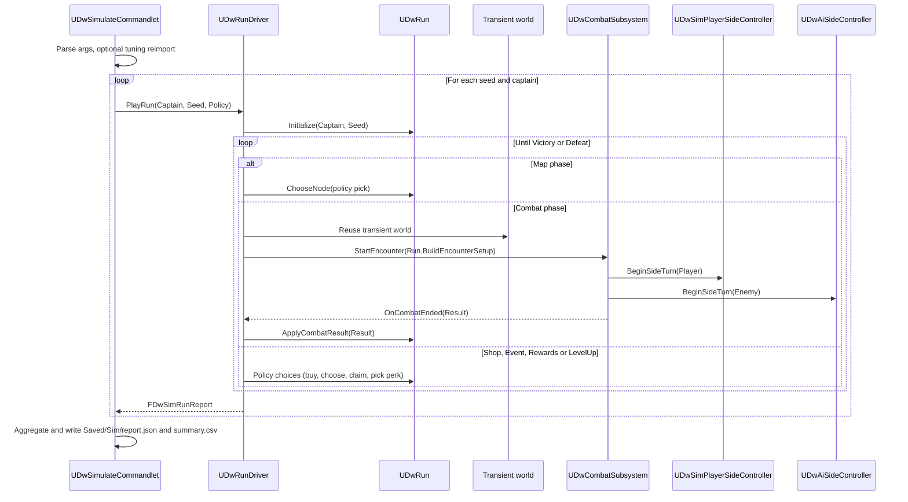

# 17 - Testing and the Headless Run Simulator

## Problem
- Every delivery needs tests (Scope rule); Brandon's review time is the bottleneck, so tests must prove behaviour without him playing.
- Balance (week 4) is "from simulations": win rate per captain, run length, where runs die, costs.
- Tools must run from the command line with pass/fail first and cost no LLM tokens.

## Decisions

### D1 - Test framework
| Option | Verdict |
|---|---|
| **A. Unreal Automation Specs (`BEGIN_DEFINE_SPEC`) for pure rules and GAS integration, run through `Tools/Test.ps1`** | **Chosen.** Built in, runs headless (`-nullrhi`), filterable by name, readable `Describe/It` |
| B. Functional tests in maps | Rejected for most tests: slow, need a map; used at most for one packaged smoke |
| C. External C++ test framework (GoogleTest/Catch2) | Rejected: can't touch UObjects/GAS easily |

### D2 - Simulator
| Option | Verdict |
|---|---|
| **A. A commandlet that runs the real `UDwRun` + real `UDwCombatSubsystem` + real GAS in a transient game world with instant presentation; both sides played by the utility brain with profiles** | **Chosen.** Tests the shipped rules, no private copies (tools-engineer rule) |
| B. A separate fast "math model" of combat | Rejected: drifts from the game; balance data would lie |
| C. Automated play of the packaged game at high speed | Rejected for balance (too slow); kept as a packaged smoke test |

## Test layers

| Layer | Name filter | World | Speed | Written by |
|---|---|---|---|---|
| 1. Pure rules | `DeadwaterRun.Rules.*` | none | ms | system owner |
| 2. GAS/combat integration | `DeadwaterRun.Gas.*`, `DeadwaterRun.Combat.*`, `DeadwaterRun.AI.*` | `FDwTestWorld` | < 1 s each | system owner |
| 3. View models | `DeadwaterRun.UI.*` | `FDwTestWorld` | fast | ui-engineer |
| 4. Data | `DeadwaterRun.Data.*` + `-run=DataValidation` | none | seconds | tools-engineer |
| 5. Simulator smoke | `DeadwaterRun.Sim.*` | transient | ~1 min | tools-engineer |
| 6. Regression | `DeadwaterRun.Regression.<BugId>` | any | fast | qa-tester |
| 7. Packaged smoke | `DeadwaterRun.exe -DwAutoplay -DwSeed=1` | game | minutes | release-engineer runs, tools-engineer builds |

### `FDwTestWorld` (Tests/, tools-engineer)
- RAII helper: creates a `UWorld` of type `Game` with `UWorld::CreateWorld`, a `FWorldContext`, initialises subsystems and actors for play, forces `UDwPresentationSubsystem` instant mode, and destroys everything in the destructor.
- Helpers: `StartTestEncounter(const FDwTestEncounter&)` (inline layout ASCII, units, ship HP), `Unit(Name)`, `Submit(Command)`, `ExpectAttribute(Unit, Attr, Value)`, `RunEnemyTurn()`, `MakeSnapshot()`.
- Data: uses real definitions and tuning; tests needing odd values build inline rows.

## The simulator



| Class | Folder | Responsibility |
|---|---|---|
| `UDwRunDriver` | Sim/ (runtime, so the packaged autoplay smoke can use it) | Plays one run end to end through `UDwRun` and the combat subsystem; enforces a step cap (stuck-run detection) |
| `UDwSimPlayerSideController` | Sim/ | Player side via `UDwCrewAiBrain` + `DA_AiProfile_SimPlayer` |
| `UDwSimPolicy : UDwDefinitionBase` | Sim/ | Map/shop/event/reward/perk choice heuristics with weights (e.g. repair below X% hull, prefer fights early); several assets = several "player types" |
| `FDwSimRunReport` | Sim/ | Seed, captain, outcome, node reached, cause of defeat, rounds per fight, outcomes (sunk/plunder/surrender), gold per node, purchases, crew deaths, levels, estimated minutes |
| `UDwSimulateCommandlet` | DeadwaterRunEditor/ | CLI, batching, aggregation, JSON/CSV output |

Command line (wrapped by `Tools/Simulate.ps1`):
```
UnrealEditor-Cmd.exe DeadwaterRun.uproject -run=DwSimulate -Runs=1000 -Captain=All -Seed=1 -Policy=DA_SimPolicy_Default -ImportTuning -Out=Saved/Sim/report.json -nullrhi -unattended -nosplash -nosound
```
Output first line: `SIM PASS 3000 runs | win TeamLeader 41% Fearmongerer 38% Conqueror 44% | avg 31.2 min | stuck 0` (or `SIM FAIL ...` with the first error).

Metrics (balance-designer targets from `Docs/Scope.md` and the ICP): win rate per captain (similar), estimated run length (~30 min: rounds x player actions x `SecondsPerAction` from `DA_SimPolicy`, calibrated against QA playtests), where runs die (node histogram), outcome mix (sink vs plunder vs surrender), gold at each shop and % that can't afford repair before the boss, levels per encounter (~1), crew deaths per run.

Determinism: the same build, data, seed and policy produce a byte-identical report (tested in `DeadwaterRun.Sim.Determinism`).

## Command-line tools (`Tools/`, tools-engineer)
| Script | Does | First output line |
|---|---|---|
| `Build.ps1` | Builds `DeadwaterRunEditor` Development Win64 | `BUILD PASS (0 warnings)` |
| `Test.ps1 -Filter <prefix>` | Runs automation tests headless, writes `Saved/Automation/report` | `TEST PASS 212/212` |
| `Validate.ps1` | Data validation commandlet | `VALIDATE PASS 0 errors 3 warnings` |
| `ImportTuning.ps1` | Reimports every `Tuning/*.json` | `IMPORT PASS 13 tables` |
| `Simulate.ps1` | Simulator | `SIM PASS ...` |
| `MapSweep.ps1 -Seeds 10000` | Map generator sweep | `MAPS PASS 10000/10000` |

## Who writes which tests
- System owners write layer 1-3 tests for every rule they add (gameplay-engineer, ai-engineer, ui-engineer).
- tools-engineer owns the harness, data tests, simulator and scripts.
- qa-tester writes regression tests for bugs it finds and verifies deliveries; bug reports in `Docs/Bugs/`.
- balance-designer runs the simulator and writes `Docs/Balance/` reports; never changes code.

## Build order (tools-engineer)
1. DW-003: `Tools/Build.ps1`, `Tools/Test.ps1`, one placeholder test.
2. DW-108: `FDwTestWorld`, helpers, `UDwContentValidator`, `Tools/Validate.ps1`.
3. DW-212: run driver, policies, commandlet, reports, `DeadwaterRun.Sim.*`.
4. DW-309: balance dashboard EUW (`Editor-Tools.md`).
5. DW-407: packaged `-DwAutoplay` smoke and combat replays.

## What the player sees
- A game that doesn't break when they do something odd, and a difficulty curve that was measured over thousands of runs, not guessed.
