# Roadmap and Tickets

- Timeline from `Docs/Scope.md`. Launch **Thu 2026-12-03**. Steam: store page submitted **~Nov 12**, live **by Nov 19**, build submitted **~Nov 25**.
- Bottleneck is Brandon's review (15 h/week, approvals batched daily), so tickets are sized to review in 30 minutes or less, and every ticket's proof is a test run plus a screenshot or clip.
- Ticket IDs: `DW-<week><nn>`. Agents are only those in the `DeadwaterRun.md` roster.

## Gantt

```mermaid
gantt
    title Deadwater Run v1.0
    dateFormat YYYY-MM-DD
    axisFormat %b %d

    section Week 0
    Architecture approval (Brandon)        :crit, a1, 2026-10-24, 1d
    DW-002 Template cleanup                :crit, w002, 2026-10-24, 1d
    DW-003 Editor module and scripts       :w003, after w002, 1d
    DW-004 Core tags data layout           :crit, w004, after w002, 1d
    DW-005 Asset options                   :w005, 2026-10-24, 10d
    DW-006 Release checklist and package   :w006, after w002, 2d

    section Week 1
    DW-101 GAS foundation                  :crit, w101, after w004, 2d
    DW-102 Grid board                      :w102, after w004, 2d
    DW-103 Combat core                     :crit, w103, after w101, 2d
    DW-104 Core actions                    :crit, w104, after w103, 2d
    DW-105 Input and camera                :w105, after w103, 2d
    DW-106 Enemy AI v1                     :w106, after w103, 2d
    DW-107 UI foundation and combat HUD    :w107, after w103, 2d
    DW-108 Test harness and validator      :w108, after w003, 3d
    DW-109 Tuning import                   :w109, after w004, 2d
    DW-110 Deck layout editor              :w110, after w102, 2d
    DW-111 Quick launch and cheats         :w111, after w103, 2d
    DW-112 Seed tuning values              :w112, after w109, 1d
    DW-113 Audio setup                     :w113, after w004, 3d
    DW-114 Cue bases and music             :w114, after w101, 2d
    DW-115 QA combat pass                  :w115, 2026-10-31, 2d
    DW-116 Package combat build            :w116, 2026-10-31, 2d
    Combat playable                        :milestone, m1, 2026-11-01, 0d

    section Week 2
    DW-201 Run state and flow              :crit, w201, 2026-11-02, 2d
    DW-202 Map generation                  :w202, 2026-11-02, 2d
    DW-203 Rewards and progression         :crit, w203, after w201, 2d
    DW-204 Shop                            :w204, after w203, 2d
    DW-205 Events framework                :w205, after w201, 2d
    DW-206 Fearmongerer                    :w206, 2026-11-02, 3d
    DW-207 Team Leader                     :w207, 2026-11-03, 3d
    DW-208 Conqueror                       :w208, 2026-11-04, 3d
    DW-209 Placeholder Kraken              :w209, after w201, 1d
    DW-210 Shell screens                   :w210, 2026-11-02, 3d
    DW-211 Run screens                     :crit, w211, after w201, 4d
    DW-212 Headless simulator              :w212, 2026-11-03, 4d
    DW-213 Wizard and map preview          :w213, 2026-11-02, 4d
    DW-214 AI captain terms                :w214, after w206, 3d
    DW-215 First balance baseline          :w215, after w212, 1d
    DW-216 Settings and music              :w216, 2026-11-04, 2d
    DW-217 QA full run pass                :w217, 2026-11-07, 2d
    DW-218 Package full run                :w218, 2026-11-06, 3d
    Audio source decided                   :milestone, m2a, 2026-11-08, 0d
    Full run playable                      :milestone, m2, 2026-11-08, 0d

    section Week 3
    DW-307 Synty art pass                  :crit, w307, 2026-11-09, 3d
    DW-308 Store page assets               :crit, w308, 2026-11-11, 2d
    Store page submitted                   :milestone, m3a, 2026-11-12, 0d
    DW-301 Kraken gameplay                 :crit, w301, 2026-11-09, 3d
    DW-302 Kraken AI                       :w302, after w301, 2d
    DW-303 Kraken HUD                      :w303, after w301, 2d
    DW-304 Abilities perks items content   :w304, 2026-11-09, 4d
    DW-305 Enemy crews content             :w305, 2026-11-09, 4d
    DW-306 Events content                  :w306, 2026-11-10, 3d
    DW-309 Balance dashboard               :w309, 2026-11-10, 3d
    DW-310 QA content sweep                :w310, 2026-11-13, 3d
    DW-311 Audio import                    :w311, 2026-11-09, 5d
    Content complete                       :milestone, m3, 2026-11-15, 0d

    section Week 4
    DW-401 Balance pass                    :crit, w401, 2026-11-16, 5d
    DW-402 UI juice                        :w402, 2026-11-16, 5d
    DW-403 Mix pass                        :w403, 2026-11-17, 4d
    DW-404 Playtests and bug bash          :w404, 2026-11-16, 6d
    DW-405 Polish fixes                    :w405, 2026-11-17, 5d
    DW-406 Store live and RC dry run       :w406, 2026-11-19, 3d
    DW-407 Autoplay smoke and replays      :w407, 2026-11-16, 3d
    Store page live                        :milestone, m4, 2026-11-19, 0d

    section Week 5
    DW-501 Release candidate               :crit, w501, 2026-11-23, 3d
    DW-502 QA RC regression                :w502, 2026-11-23, 5d
    DW-503 Final tuning                    :w503, 2026-11-23, 2d
    DW-504 RC fixes                        :w504, 2026-11-24, 5d
    Build submitted                        :milestone, m5, 2026-11-25, 0d

    section Week 6
    DW-601 Launch checklist                :crit, w601, 2026-11-30, 4d
    DW-602 Launch smoke                    :w602, 2026-12-02, 2d
    Launch                                 :milestone, m6, 2026-12-03, 0d
```



## Critical path

```mermaid
flowchart LR
    A["Brandon approves architecture Oct 24-25"] --> B["DW-002 cleanup"]
    B --> C["DW-004 tags and data layout"]
    C --> D["DW-101 GAS foundation"]
    C --> E["DW-102 grid board"]
    D --> F["DW-103 combat core"]
    E --> F
    Q1["Brandon answers C1-C8, K1 by Oct 27"] --> F
    F --> G["DW-104 actions"]
    G --> H["Combat playable Nov 1"]
    H --> I["DW-201 run state"]
    I --> J["DW-203 rewards and progression"]
    I --> K["DW-211 run screens"]
    Q2["Brandon answers K, M, P questions by Nov 2"] --> J
    J --> L["Full run playable Nov 8"]
    K --> L
    L --> M["DW-307 Synty art pass by Nov 11"]
    M --> N["DW-308 store page, submitted Nov 12"]
    Q3["Brandon content lists N1-N4, P2, P9, B1-B9 by Nov 8"] --> O["DW-301 to DW-306 content and Kraken"]
    L --> O
    O --> P["Content complete Nov 15"]
    P --> R["DW-401 balance from simulator"]
    R --> S["DW-501 release candidate"]
    S --> T["Build submitted Nov 25"]
    T --> U["DW-601 launch Dec 3"]
```



Decision deadlines for Brandon (from `Open-Questions.md`) are on the critical path: board/combat basics by **Oct 27**, captain/map/economy rules by **Nov 2**, content lists and Kraken details by **Nov 8**, audio source by **Nov 8**.

## Immediate next steps
1. Brandon reviews and approves this architecture set (or marks changes) - start with `00-Overview.md`, `02-GAS-Foundation.md`, `03-Combat-Turns.md`, `13-Data-Layout.md`.
2. Brandon answers the **Oct 27** questions in `Open-Questions.md` (C1-C8, K1, C15) and confirms deleting `DeadwaterRunPlayerController` (O5) and the art-integration owner (O1).
3. Orchestrator routes DW-002 (gameplay-engineer) - cleanup and skeleton.
4. In parallel: DW-005 (asset-scraper: audio, animations, fonts, Kraken model) and DW-006 (release-engineer: checklist with Steam dates).
5. After DW-002: DW-003 (tools-engineer) and DW-004 (gameplay-engineer) in parallel.
6. After DW-004: DW-101 and DW-102 in parallel worktrees; DW-109 and DW-113 alongside.
7. Orchestrator asks Brandon to update `Docs/Scope.md`, `context/offer.md` and `.claude/agents/gameplay-engineer.md` for the doc inconsistencies (Open-Questions D1-D11).
8. Daily: QA verifies yesterday's deliveries before Brandon's batched review.

## Tickets - Week 0 (Oct 24-25)

```
Agent:       gameplay-engineer
Goal:        DW-002 Remove UE template code and content; lay down the runtime module skeleton
Context:     Docs/Architecture/01-Project-Structure.md (cleanup table, Build.cs and .uproject changes), 16-Shell.md (levels)
Acceptance:  - Variant_Strategy, Variant_TwinStick, DeadwaterRunCharacter, DeadwaterRunGameMode, DeadwaterRunPlayerController (after Brandon confirms O5) and Content/{Variant_*, TopDown, Cursor} deleted
             - Build.cs deps and include paths per doc 01; .uproject plugins and TargetAllowList per doc 01
             - Core/DwGameMode, Core/DwMenuGameMode, Core/DwPlayerController stubs; L_MainMenu and L_Sea exist; default maps set
             - DeadwaterRunEditor builds with zero warnings; log shows GameplayAbilities and CommonUI loaded
Proof:       Build output, log excerpt, editor screenshot with L_Sea open, git diff --stat
Out of scope: Any gameplay code; the editor module (DW-003)
```

```
Agent:       tools-engineer
Goal:        DW-003 Create the DeadwaterRunEditor module and the build/test scripts
Context:     01-Project-Structure.md (modules), 17-Testing-Simulator.md (Tools table)
Acceptance:  - Source/DeadwaterRunEditor module (Editor type) with Build.cs deps from doc 01, empty FDeadwaterRunEditorModule
             - Tools/Build.ps1 and Tools/Test.ps1 print PASS/FAIL first, return non-zero on failure
             - One placeholder pure test DeadwaterRun.Rules.Placeholder passes headless
Proof:       Command lines and output of Build.ps1 and Test.ps1
Out of scope: Validators, commandlets, any runtime code
```

```
Agent:       gameplay-engineer
Goal:        DW-004 Shared core layer: native tags, logs, types, definitions, Asset Manager, tuning row structs (data layout agreed)
Context:     02-GAS-Foundation.md (tags), 13-Data-Layout.md (definitions, tables, JSON), 05, 09, 10, 11, 12 (definition fields)
Acceptance:  - Core/DwGameplayTags with every namespace in doc 02; Core/DwLog; Core/DwTypes (EDwSide, FDwUnitHandle, EDwTurnTickPoint)
             - UDwDefinitionBase, UDwAssetManager, UDwGameData; Asset Manager config in DefaultGame.ini
             - All definition classes from doc 13 with their fields (no behaviour yet) and IsDataValid stubs
             - All FDw*TuningRow structs and DT_* assets; Tuning/*.json files exist with numbers from DeadwaterRun.md, other fields 0
             - Builds with zero warnings
Proof:       Build output; screenshot of Asset Manager audit listing the primary types; list of tables
Out of scope: Ability/combat behaviour; the import commandlet (DW-109); tuning values beyond the design doc
```

```
Agent:       asset-scraper
Goal:        DW-005 Options for assets the Synty Pirate and VFX packs don't cover
Context:     DeadwaterRun.md (Assets), Scope.md (audio decided by Nov 8), 15-Audio-VFX.md cue catalogue, 08-Kraken-Boss.md
Acceptance:  2-3 options each, with link, price, commercial license, style fit, risks, recommendation:
             (a) SFX pack covering the cue catalogue, (b) music (menu, map, combat, boss, enraged), (c) character animations for Synty
             rigs (idle, walk, sword attack, pistol/rifle shot, cannon fire, hit, death, climb, cower), (d) fonts, (e) a Kraken model
             if Synty has none
Proof:       Options report in the final message
Out of scope: Downloading, buying or importing anything
```

```
Agent:       release-engineer
Goal:        DW-006 Release checklist with Steam dates and a first Shipping package of the cleaned project
Context:     Scope.md deadlines, 18-Packaging-Release.md
Acceptance:  - Docs/Release/Checklist.md (dates Nov 12/19/25, Dec 3, Valve review lead times) and Docs/Release/StorePage.md skeleton
             - Build/Package.ps1 produces a Win64 Shipping build into Build/Out; exe launches to L_MainMenu
             - Staged build contains no ModelContextProtocol/Terminal/AllToolsets binaries
Proof:       Commands, exit codes, package size, screenshot of the packaged game at the menu
Out of scope: Steam uploads, store page publishing, any game code
```

## Tickets - Week 1 (Oct 26 - Nov 1): one full combat playable with placeholder art

```
Agent:       gameplay-engineer
Goal:        DW-101 GAS foundation: ASC, attribute sets, damage exec, turn-duration GE component, ability base, shared GEs
Context:     02-GAS-Foundation.md (all sections), 03-Combat-Turns.md (turn boundaries)
Acceptance:  - UDwAbilitySystemComponent (grant from definitions, HandleTurnBoundary, NotifyHealthDepleted, OnAbilityEnded)
             - UDwUnitAttributeSet and UDwShipAttributeSet with clamps, meta attributes, State.Dead, Status.Afraid toggle
             - UDwDamageExecution calling pure FDwDamageRules; UDwTurnDurationComponent with countdown in the ASC
             - UDwGameplayAbility base (costs incl. action/move points and single-choice rule, targeting struct, GatherValidTargets,
               PreviewOutcome, ResolveTargets with guard redirect, MakeTunedSpec); FDwGameplayAbilityTargetData_Grid
             - Shared GE assets from doc 02 referenced in DA_GameData
Proof:       Test.ps1 -Filter DeadwaterRun.Rules.Damage and DeadwaterRun.Gas output (tests listed in doc 02)
Out of scope: Concrete abilities (DW-104), combat subsystem (DW-103)
```

```
Agent:       gameplay-engineer
Goal:        DW-102 Grid board: model, rules, pathfinding, LOS, deck layouts, board builder, ADwBoard highlights
Context:     04-Grid-Board.md, Open-Questions C1-C6 (use the doc defaults behind FDwGridRules flags if unanswered)
Acceptance:  - FDwTile, FDwGridModel, FDwGridRules (from DT_CombatTuning), FDwPathfinder, FDwLineOfSight, FDwTargetingQuery
             - UDwDeckLayout with IsDataValid; FDwBoardBuilder::BuildShipBattle
             - ADwBoard: TileToWorld/WorldToTile, highlight layers, editor preview of a layout
             - Two placeholder layouts (player ship, enemy ship) built from ASCII in a test helper and saved as assets
Proof:       Test.ps1 -Filter DeadwaterRun.Rules.Grid output; screenshot of both decks with move highlights in L_Sea
Out of scope: Kraken arena (DW-301), layout painter (DW-110), Synty alignment (DW-307)
```

```
Agent:       gameplay-engineer
Goal:        DW-103 Combat core: combat subsystem, turn manager, side controllers, commands, snapshot, events, outcome, death and sinking
Context:     03-Combat-Turns.md, 06-Ship-Cannons.md (ADwShip, sinking), 05-Crew-Captains.md (spawn and write-back)
Acceptance:  - UDwCombatSubsystem API from doc 03 incl. SubmitCommand validation results and FDwCombatRecord
             - UDwTurnManager: player first, side turns, enemy unit sequence, skip incapacitated, durations ticked at boundaries
             - IDwCombatSideController; FDwCombatCommand/Snapshot/Event/Result/EncounterSetup; FDwCombatOutcomeRules priority list
             - ADwCombatUnit and ADwShip spawned from a placeholder encounter definition (3 crew vs 3 enemies, 250 HP ships)
             - Unit death and ship sinking per doc 03 (boarders die, no kill XP for sinking)
Proof:       Test.ps1 -Filter DeadwaterRun.Rules.Outcome and DeadwaterRun.Combat output; screenshot of the spawned fight
Out of scope: Concrete abilities (DW-104), input (DW-105), AI decisions (DW-106), run state (DW-201)
```

```
Agent:       gameplay-engineer
Goal:        DW-104 Core actions: move, basic melee and ranged attack, fire cannon, use item, presentation tasks
Context:     02-GAS-Foundation.md (ability classes, presentation), 06-Ship-Cannons.md, 10-Economy-Shop-Loot.md (items)
Acceptance:  - UDwGA_Move, UDwGA_EffectPayload, UDwGA_FireCannon, UDwGA_UseItem; UDwAT_PlayPresentation, UDwAT_MoveAlongPath;
               UDwPresentationSubsystem with instant mode
             - BP abilities: GA_Move, GA_Attack_Sword, GA_Attack_Rifle, GA_FireCannon, GA_UseItem; DA_Item_HealthRestore,
               DA_Item_ManaRestore
             - Cannon: own cannon tile only, once per cannon per side turn, 70 damage to the enemy ship
Proof:       Tests for each action (doc 02/06 lists); clip of a crew member moving, attacking and firing a cannon
Out of scope: Captain abilities (DW-206 to DW-208), Synty art
```

```
Agent:       gameplay-engineer
Goal:        DW-105 Player input, combat interaction state, camera rig
Context:     03-Combat-Turns.md (player input), 14-UI.md (what the HUD reads)
Acceptance:  - ADwPlayerController implements IDwCombatSideController; Enhanced Input assets IMC_Combat and IA_* from doc 03
             - UDwCombatInteraction: select unit, select ability, hover, click, cancel; reachable/path/target highlights; previews
             - ADwCameraRig framing the board with limited pan and zoom
Proof:       Clip: select, move with path preview, target with highlight, cancel, end turn with Space
Out of scope: Widgets (DW-107)
```

```
Agent:       ai-engineer
Goal:        DW-106 Enemy crew AI v1 through the shared command path
Context:     07-Enemy-AI.md, 03-Combat-Turns.md (side controller contract, loop-until-latent)
Acceptance:  - UDwAiSideController, UDwAiBrain, UDwCrewAiBrain, UDwAiProfile, FDwAiScoring, FDwAiTuningRow + Tuning/AiTuning.json
             - Core terms: damage, kill, ship damage, danger, low-Health focus, sinking-risk avoidance
             - Deterministic per seed; enemy turn under 5 ms on a 12x24 board
Proof:       Test.ps1 -Filter DeadwaterRun.AI output (scenarios in doc 07); clip of an enemy turn
Out of scope: Kraken brain, captain-ability terms (DW-214)
```

```
Agent:       ui-engineer
Goal:        DW-107 UI foundation (CommonUI layers, manager, base classes, view models) and combat HUD v1
Context:     14-UI.md, 03-Combat-Turns.md (snapshot, events, interaction)
Acceptance:  - CommonUI configured (viewport client, input data); WBP_PrimaryLayout with 4 layers; UDwUIManagerSubsystem; UDwUIScreenSet
             - UDwViewModelBase, UDwActivatableScreen, UDwUserWidget with juice hooks from doc 14
             - UDwCombatHudViewModel, UDwUnitViewModel, UDwActionViewModel; WBP_CombatHud: crew cards (HP/MP/status), enemy bars,
               both ship bars with numbers, action bar with costs and disabled reasons, End Turn, turn banner; floating text pool
Proof:       Screenshots at 1080p and 1440p; view model tests DeadwaterRun.UI output
Out of scope: Menus and run screens (DW-210, DW-211); animations (DW-402)
```

```
Agent:       tools-engineer
Goal:        DW-108 Test harness, data validation framework, Deadwater editor menu
Context:     17-Testing-Simulator.md (FDwTestWorld, layers), Editor-Tools.md (T1, T3)
Acceptance:  - FDwTestWorld and helpers (StartTestEncounter with inline ASCII layout, Submit, ExpectAttribute, RunEnemyTurn)
             - UDwContentValidator cross-asset rules from Editor-Tools T3 (those whose classes exist); Tools/Validate.ps1
             - FDwEditorMenus "Deadwater" toolbar menu
             - DeadwaterRun.Data.AllDefinitionsValid test
Proof:       Validate.ps1 and Test.ps1 output; a known-bad asset in Dev/TestData fails validation with a clear message
Out of scope: Commandlets other than validation; changing game rules
```

```
Agent:       tools-engineer
Goal:        DW-109 Tuning JSON import/export commandlet and editor buttons
Context:     13-Data-Layout.md (JSON format, pipeline), Editor-Tools.md (T4)
Acceptance:  - -run=DwImportTuning reimports every Tuning/*.json strictly (unknown or missing fields fail); export writes JSON back
             - Tools/ImportTuning.ps1 prints IMPORT PASS/FAIL first; Deadwater menu buttons Reimport Tuning and Export JSON
             - Validator check: DataTable older than its JSON is an error
Proof:       Command output for a good import and a deliberately bad field
Out of scope: Changing any tuning value
```

```
Agent:       tools-engineer
Goal:        DW-110 Deck layout painter and ship alignment dev map
Context:     04-Grid-Board.md (UDwDeckLayout, tile kinds), Editor-Tools.md (T5, T6)
Acceptance:  - FDwDeckLayoutDetails grid painter with palette, owner, blocker height, fill, live validation strip
             - ASCII import/export buttons
             - L_Dev_ShipAlign with BP_ShipPreview showing the grid over a ship mesh
Proof:       Clip of painting a deck, exporting ASCII, and seeing it in the alignment map
Out of scope: Pathfinding/LOS code (DW-102)
```

```
Agent:       tools-engineer
Goal:        DW-111 "Play in Deadwater" quick launch and cheat manager
Context:     Editor-Tools.md (T8, T9), 16-Shell.md (ADwGameMode), 03-Combat-Turns.md
Acceptance:  - UDwDevSettings (per-user); content browser action on encounter definitions starts PIE in L_Sea in that fight with a
               chosen captain, crew level and seed (event/shop launch added when DW-204/DW-205 land)
             - UDwCheatManager commands from T9, not created in Shipping
Proof:       Clip: right-click encounter -> fight starts; Dw.Win ends it
Out of scope: Gameplay rules
```

```
Agent:       balance-designer
Goal:        DW-112 Seed Tuning/*.json with the design numbers and list placeholders
Context:     DeadwaterRun.md numbers, 13-Data-Layout.md tables
Acceptance:  - Every number in DeadwaterRun.md is in the right table (100 HP/20 MP, 5 move, 250 ship HP, 70 cannon, 150 base gold,
               1x/1.5x, 100/50/30 shop, 500 Kraken HP, 30% enrage, 50/20/40 Kraken damage, 3-5 hits, 15 heal, 15 x 6 pistols, range 10,
               6-tile charge, 3 Fear, +1%/20% kill bonus, 60/40 events)
             - Docs/Balance/Placeholders.md lists every other value with 2-3 candidate numbers for Brandon
Proof:       ImportTuning.ps1 output; diff of Tuning/*.json
Out of scope: Rules or code
```

```
Agent:       sound-wrangler
Goal:        DW-113 Audio foundation: sound classes, mix, concurrency, cue map and music set assets
Context:     15-Audio-VFX.md
Acceptance:  - SC_Master/Music/SFX/UI, SM_Base, SCON_Hits/Cannon/UI; DA_AudioCueMap and DA_MusicSet created (placeholder engine sounds)
             - One cue (GameplayCue.Hit.Melee) plays its sound through the map in-game
Proof:       Clip with sound of a melee hit
Out of scope: Importing third-party audio (waits for Brandon's Nov 8 decision)
```

```
Agent:       gameplay-engineer
Goal:        DW-114 GameplayCue bases, audio cue map lookup, music subsystem, placeholder hit and cannon cues
Context:     15-Audio-VFX.md (classes, cue catalogue)
Acceptance:  - UDwGameplayCueNotify_Burst, ADwGameplayCueNotify_Looping, UDwAudioCueMap, UDwMusicSet, UDwMusicSubsystem
             - GC_Hit_Melee, GC_Cannon_Fire, GC_Cannon_Impact, GC_Unit_Death with placeholder Niagara
             - Instant mode spawns no Niagara components (test)
Proof:       Clip of hit and cannon cues; test output
Out of scope: Synty VFX (DW-307), sound assets (sound-wrangler)
```

```
Agent:       qa-tester
Goal:        DW-115 Verify "one full combat playable" and try to break it
Context:     Scope.md week 1 exit criteria, 03-Combat-Turns.md, 06-Ship-Cannons.md
Acceptance:  - Plays at least 5 fights via quick launch: win by sinking, win by crew wipe, lose by crew death, lose by ship sinking,
               boarding then sinking the enemy ship with a boarder aboard
             - Edge cases: zero MP, end turn without acting, clicking during resolution, frozen/cowering (via cheats)
             - Bug reports in Docs/Bugs/ with repro, severity, owner, suggested fix
Proof:       Bug list + clips
Out of scope: Fixing bugs
```

```
Agent:       release-engineer
Goal:        DW-116 Package the week-1 combat build
Context:     18-Packaging-Release.md
Acceptance:  Shipping build launches to the menu; a Development build reaches the placeholder fight via -DwTestEncounter
Proof:       Commands, exit codes, screenshot
Out of scope: Steam upload
```

## Tickets - Week 2 (Nov 2-8): full run playable, placeholder boss; audio source decided Nov 8

```
Agent:       gameplay-engineer
Goal:        DW-201 Run state and run flow
Context:     09-Run-Map.md (run classes, seeds, node entry), 05-Crew-Captains.md (roster), 16-Shell.md (travel)
Acceptance:  FDwRunState and friends, UDwRun with phase guards, UDwRunSubsystem, FDwRunRandom, FDwCrewFactory, UDwCaptainDefinition
             and 3 captain assets (abilities may be placeholders), ADwGameMode phase bridge, combat write-back and permadeath
Proof:       DeadwaterRun.Rules.Run tests; clip: captain select -> map -> fight -> back to map
Out of scope: Map generation rules (DW-202), rewards (DW-203)
```

```
Agent:       gameplay-engineer
Goal:        DW-202 Seeded map generation and validator
Context:     09-Run-Map.md (map generation), Open-Questions M1-M6
Acceptance:  UDwMapRules + DA_MapRules, FDwMapGenerator, FDwMapValidator (all rules, all failures reported), encounter assignment
Proof:       DeadwaterRun.Rules.Map tests incl. 10,000-seed sweep, identical output for identical seeds
Out of scope: Map screen (DW-211)
```

```
Agent:       gameplay-engineer
Goal:        DW-203 Rewards, plunder multipliers, XP, level-ups and perks
Context:     10-Economy-Shop-Loot.md (rewards), 12-Progression.md, 05-Crew-Captains.md (captain hooks)
Acceptance:  FDwRewardRules, FDwProgressionRules, FDwCaptainRules XP hooks, pending rewards and level-ups, ClaimRewards, ChoosePerk,
             UDwPerkDefinition/UDwPerkPool with 3 placeholder perks
Proof:       Economy and progression tests (doc lists)
Out of scope: Final perk content (DW-304)
```

```
Agent:       gameplay-engineer
Goal:        DW-204 Shop: repair, abilities, items, recruit, disband, ship upgrades
Context:     10-Economy-Shop-Loot.md (shop), 06-Ship-Cannons.md (upgrades)
Acceptance:  UDwShopDefinition, FDwShopRules, every EDwPurchaseResult, UDwShipUpgradeDefinition with 1 placeholder upgrade
Proof:       Shop tests; quick-launch shop clip
Out of scope: Shop screen (DW-211)
```

```
Agent:       gameplay-engineer
Goal:        DW-205 Event framework with 2 placeholder events
Context:     11-Events.md
Acceptance:  UDwEventDefinition, choices, all outcome and requirement classes, FDwEventResolver (60/40, unseen first), 1 good + 1 bad event
Proof:       Event tests incl. 10,000-roll valence split
Out of scope: Event writing (Brandon, DW-306)
```

```
Agent:       gameplay-engineer
Goal:        DW-206 Fearmongerer: Fear, cower, surrender, Smoke and Fire, Six Pistols, Dread Reputation
Context:     05-Crew-Captains.md, Open-Questions K8-K11
Acceptance:  FDwFearRules, cower in the turn manager, surrender outcome, both abilities as BPs, Dread Reputation starting Fear
Proof:       Pure + test-world tests; clip of a surrender win
Out of scope: AI valuation of Fear (DW-214)
```

```
Agent:       gameplay-engineer
Goal:        DW-207 Team Leader: synergy, defend, Rally Cry, Grapple Hook, Veteran Crew
Context:     05-Crew-Captains.md, Open-Questions K4-K7
Acceptance:  Adjacency tag upkeep, synergy per K4 answer, GA_Defend + redirect, Rally Cry, UDwGA_Grapple, Veteran Crew multipliers
Proof:       Tests; clip of grapple pull and a guarded hit
Out of scope: Other captains
```

```
Agent:       gameplay-engineer
Goal:        DW-208 Conqueror: extra move, sword only, single-choice crew, Charge, Eye of the Tiger, kill bonus
Context:     05-Crew-Captains.md, Open-Questions K1-K3, K12
Acceptance:  Captain/crew combat GEs, weapon tag filter in offers, UDwGA_Charge, Eye of the Tiger BP, kill bonus counter + GE refresh
Proof:       Tests; clip of a charge kill and the bonus increasing
Out of scope: Other captains
```

```
Agent:       gameplay-engineer
Goal:        DW-209 Placeholder Kraken boss encounter
Context:     08-Kraken-Boss.md (placeholder)
Acceptance:  Encounter kind Kraken on a placeholder arena, 500 HP body, VictoryBoss -> Victory phase
Proof:       Clip of beating the placeholder boss and reaching the summary
Out of scope: Real Kraken (DW-301)
```

```
Agent:       ui-engineer
Goal:        DW-210 Shell screens: main menu, captain select, settings, pause, confirm, run summary
Context:     14-UI.md (screens), 16-Shell.md
Acceptance:  Screens from the table, wired to UDwRunSubsystem/UDwGameUserSettings; Esc behaviour per doc 16
Proof:       Screenshots 1080p/1440p; clip of new run -> pause -> abandon -> summary
Out of scope: Run screens (DW-211)
```

```
Agent:       ui-engineer
Goal:        DW-211 Run screens: map, rewards, level-up, shop, event
Context:     14-UI.md, 09-12 docs
Acceptance:  Each screen uses its view model and only calls UDwRun intents; disabled reasons shown
Proof:       Screenshots; clip of a full run with placeholder boss
Out of scope: Juice
```

```
Agent:       tools-engineer
Goal:        DW-212 Headless run simulator v1
Context:     17-Testing-Simulator.md (simulator), 07-Enemy-AI.md (player policy)
Acceptance:  UDwRunDriver, UDwSimPlayerSideController, UDwSimPolicy, FDwSimRunReport, -run=DwSimulate, Tools/Simulate.ps1,
             DeadwaterRun.Sim.Smoke and Determinism tests; 1,000 runs under 10 minutes
Proof:       Simulate.ps1 output and report.json sample
Out of scope: Balance changes
```

```
Agent:       tools-engineer
Goal:        DW-213 Content wizard, map preview, description preview
Context:     Editor-Tools.md (T2, T7, T12)
Acceptance:  Wizard creates every content type with its JSON row; EUW_MapPreview with validator results and sweep; description token preview
Proof:       Clip of creating an ability with the wizard and seeing it in a shop; MapSweep.ps1 output
Out of scope: Game rules
```

```
Agent:       ai-engineer
Goal:        DW-214 AI terms for captain mechanics and the simulator player profile
Context:     07-Enemy-AI.md, 05-Crew-Captains.md
Acceptance:  Scoring for Fear/surrender proximity, guard, freeze, grapple and charge positioning; DA_AiProfile_SimPlayer
Proof:       AI scenario tests; simulator runs for all 3 captains without stuck turns
Out of scope: Kraken brain
```

```
Agent:       balance-designer
Goal:        DW-215 First simulator baseline report
Context:     17-Testing-Simulator.md metrics, ideal-customer-profile.md
Acceptance:  Docs/Balance/2026-11-baseline.md: win rate per captain, run length estimate, death nodes, outcome mix, 2-3 options per issue
Proof:       Simulator command and output
Out of scope: Changing values (proposal only this week)
```

```
Agent:       gameplay-engineer
Goal:        DW-216 Game user settings and music states
Context:     16-Shell.md, 15-Audio-VFX.md
Acceptance:  UDwGameUserSettings (volumes, game speed, screen shake), ApplyAudio/ApplyPresentation, music state changes per phase
Proof:       Shell tests; clip of volume slider changing music
Out of scope: Settings screen layout (DW-210)
```

```
Agent:       qa-tester
Goal:        DW-217 Verify "full run playable start to finish"
Context:     Scope.md week 2 exit criteria
Acceptance:  One run per captain to the placeholder boss; shop-after-event, crew death mid-plunder, recruit at max crew, abandon and restart
Proof:       Bug reports with clips/replays
Out of scope: Fixing
```

```
Agent:       release-engineer
Goal:        DW-218 Full-run package, store page checklist, Steam vdf templates
Context:     18-Packaging-Release.md
Acceptance:  Shipping package of the full run; Docs/Release/StorePage.md with every asset size and text field; Build/Steam templates
Proof:       Commands, screenshot
Out of scope: Uploading, submitting
```

## Tickets - Weeks 3-6 (coarser; refine at each week's start)

| ID | Agent | Goal | Context | Acceptance / Proof | Out of scope |
|---|---|---|---|---|---|
| DW-301 | gameplay-engineer | Kraken gameplay: definition, arena, body + tentacles, 5 moves, intent storage | 08 | Kraken tests; clip of both phases | AI choice logic |
| DW-302 | ai-engineer | Kraken brain: phases, action count, tentacle scaling, intents | 08, 07 | Kraken AI tests; simulator boss win rate | New moves |
| DW-303 | ui-engineer | Kraken HUD: boss bar, phase banner, intents, tentacle bars, danger tiles hookup | 14, 08 | Screenshots | Juice |
| DW-304 | gameplay-engineer | Content: ~12 crew abilities, final perk pools, 2 items, ship upgrades (from Brandon's lists N1, P2, P9) | 02, 12, 06 | Each ability tested; validation clean | New ability classes unless approved |
| DW-305 | gameplay-engineer | Content: 4-5 enemy crews (decks, units, profiles, tiers) from N2/N3 | 07, 13 | Quick-launch clip of each crew | AI code |
| DW-306 | gameplay-engineer | Content: 10-12 events from Brandon's text | 11 | Validation clean; each event quick-launched | Writing text |
| DW-307 | gameplay-engineer (pending O1) | Synty art pass: ships, characters, animations, environment, Niagara for every cue; layouts aligned. **Done by Nov 11 for store screenshots** | 15, 04 | Screenshots of combat, map, shop | UI art |
| DW-308 | release-engineer | Store page package for Brandon to submit Nov 12 | 18 | Checklist complete with real screenshots | Pressing submit |
| DW-309 | tools-engineer | Balance dashboard EUW | Editor-Tools T11 | Clip of running and comparing reports | Balance values |
| DW-310 | qa-tester | Content sweep: every ability, crew, event, Kraken phase; cross-system cases | all | Bug reports | Fixes |
| DW-311 | sound-wrangler | Import approved audio; fill cue map and music set | 15 | Clip with sound per cue | Unapproved audio |
| DW-401 | balance-designer | Simulator-driven tuning pass: captain parity, ~30 min runs, real heal-vs-upgrade decisions | 13, 17 | Before/after report in Docs/Balance | Rules or code |
| DW-402 | ui-juice-engineer | UI animations and UI sounds on every screen | 14 | Clip per interaction | Layout/logic |
| DW-403 | sound-wrangler | Mix and loudness pass, concurrency tuning, settings verified | 15 | Clip with sound | New assets |
| DW-404 | qa-tester | Playtests (with Brandon) and bug bash; calibrate SecondsPerAction for run length | 17 | Bug list, playtest times | Fixes |
| DW-405 | gameplay-engineer / ai-engineer / ui-engineer | Polish fixes from DW-404 (one ticket per bug batch per owner) | bug reports | Regression tests per bug | New features |
| DW-406 | release-engineer | Confirm store page live Nov 19; RC dry-run package; beta branch prep | 18 | Checklist ticks, package output | Uploading |
| DW-407 | tools-engineer | Packaged -DwAutoplay smoke and combat replays (Editor-Tools T13) | 17 | Autoplay exits 0; replay reproduces a fight | Gameplay rules |
| DW-501 | release-engineer | Release candidate build for Brandon to submit Nov 25 | 18 | Shipping package, smoke steps 1-4 | Submitting |
| DW-502 | qa-tester | RC full regression (one run per captain, all edge-case lists) | 17 | Signed-off checklist | Fixes |
| DW-503 | balance-designer | Final tuning from RC simulator runs | 13 | Report | Rules |
| DW-504 | gameplay-engineer / ai-engineer / ui-engineer | RC fixes only (blockers and majors) | bug reports | Regression tests | Features |
| DW-601 | release-engineer | Launch checklist and launch-day steps for Dec 3 | 18 | Checklist | Pressing release |
| DW-602 | qa-tester | Launch smoke on the Steam build (beta branch, then default) | 18 | Smoke report | Fixes |
