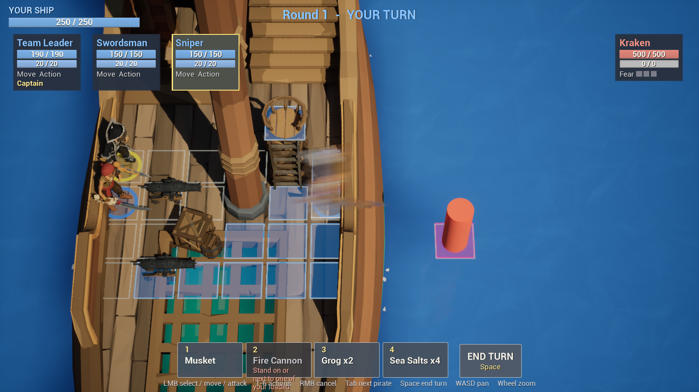
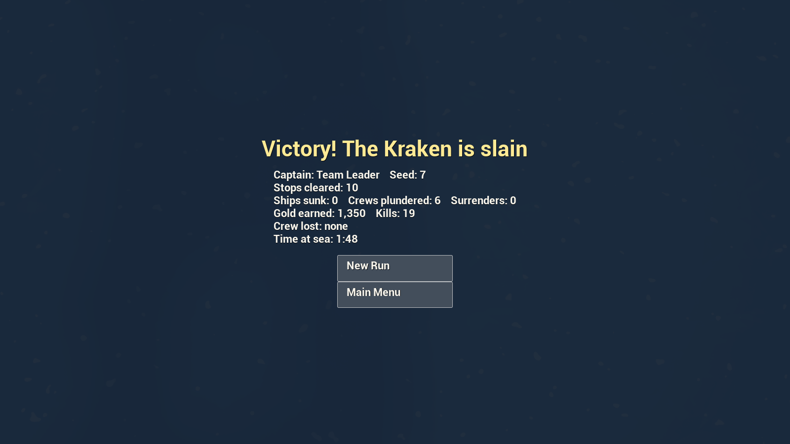

# GDD Coding Agent - Deadwater Run

A goal-driven coding agent for my capstone game **Deadwater Run** (UE 5.8, C++/GAS turn-based pirate roguelike). It reads the GDD, scans the codebase, finds missing features, ranks them, hands the top one to a Claude Code agent to build, re-scans, and repeats until every requirement is met.

## Deliverables

| # | Deliverable | Where |
|---|---|---|
| 1 | Source code | [`Tools/GddAgent/gdd-agent.js`](../../Tools/GddAgent/gdd-agent.js), [`requirements.json`](../../Tools/GddAgent/requirements.json), the code-writing agents in [`.claude/agents/`](../../.claude/agents/), and the rules they follow in [`Docs/Orchestration.md`](../Orchestration.md) |
| 2 | Working feature | **DW-209 Placeholder Kraken boss**: commit `cc60c7a`, merged in `5ffae3d`. Proof below |
| 3 | README | This file. Example outputs are in [`example-run/`](example-run/) |

## How the agent works

```
DeadwaterRun.md (GDD) ─┐
Docs/Scope.md          ├─► requirements per ticket ─► scan repo ─► gap detection ─► priority_score() ─► top ticket
Roadmap.md (tickets)  ─┘        (probes)                                                                  │
        ▲                                                                                                 ▼
        └──── re-scan ◄── Build.ps1 + Test.ps1 (--verify) ◄── claude -p --agent <owner>  (code-writing step)
                          stop when every code requirement is met, or nothing is buildable
```

| Required piece | Implementation |
|---|---|
| **Read the GDD** | `readGdd` turns every "Game Mechanics" heading into a section. `readScope` reads the must-ship list and the weekly exit criteria. `readRoadmap` reads the tickets: owner, acceptance, dependencies, dates and critical path from the gantt chart. Each ticket links to the GDD section it implements. If a GDD section has no ticket, the agent reports it. |
| **Scan the codebase** | `scan` walks `Source/ Tools/ Docs/ Tuning/ Config/ Content/DeadwaterRun`. It indexes declared C++ types, asset names, file paths and registered automation tests. |
| **Gap detection** | `detectGaps` checks each ticket's *probes*. Probes come from the identifiers in its acceptance text (`UDwRun`, `DA_MapRules`, `Tools/Simulate.ps1`, `DeadwaterRun.Rules.Map`, ...), plus the overrides in `requirements.json`. The result is `done`, `partial`, `missing` or `unverifiable`. |
| **`priority_score()`** | See the next section. |
| **Code-writing step** | `writeCode` builds a ticket in the [Orchestration](../Orchestration.md) format, adds the GDD text and the list of probes it must satisfy, and runs `claude -p --agent <owner>` on a new `<owner>/<ticket>` branch. The owner is one of the 11 agents in `.claude/agents/` (e.g. `gameplay-engineer`), and each owner knows its folders and the project rules. |
| **Iteration loop** | `main` loops: pick → write → **re-scan** → verify. If probes are still missing, it retries with the missing list as feedback (`--retries`). It **stops** when every code requirement is met, the queue is empty (everything left is blocked or not code), or `--max-iterations` is reached. |

### `priority_score()`

```
score = 10 × value × critical × milestone × unblocks × urgency × momentum / √cost
```

| Term | Value | Why |
|---|---|---|
| value | 1.0 if it implements a GDD section, 0.6 if tooling | Player-facing features first |
| critical | 1.5 if on the Roadmap critical path | Late critical-path work delays launch |
| milestone | 2.0 if the earliest unmet weekly exit criterion needs it | Finish the current milestone before starting the next |
| unblocks | 1 + 0.25 per ticket waiting on it (transitive) | Unblock other agents |
| urgency | 1 + 1 per week past its planned end (max 2); 1.2 if due within 7 days | Launch is a fixed date (Dec 3) |
| momentum | 1 + 0.5 × coverage | Finish half-built work before starting new work |
| cost | planned days, square-rooted | Cheap wins rank higher without starving big critical tickets |

**Gates (score 0):** already done; owner isn't a code agent (QA, release, balance, sound, assets); a dependency isn't built yet; no probes to check against.

## The feature the agent built: DW-209 Placeholder Kraken boss

The GDD ("At The Final Boss Node") says the run ends with a Kraken fight, and the Kraken has 500 HP. Before DW-209 the boss node existed on the map but couldn't be played, so no run could be finished. DW-209 added:

- A Kraken arena next to the player's deck (`FDwBoardBuilder::BuildKrakenArena`; no boarding)
- A boss encounter type (`FDwEncounterSetupBuilder::BuildKraken`): no enemy ship, a **500 HP** Kraken body as the only enemy, and a Tentacle Slam ability. Killing it gives `VictoryBoss`, which goes to the **Victory** run summary
- Content made by code: `DA_Deck_KrakenArena`, `DA_Unit_KrakenBody`, `GA/DA_Kraken_TentacleSlam`, `DA_Encounter_KrakenPlaceholder`
- 11 tests (`DeadwaterRun.Run.Kraken`), including a sweep over 3 captains × 100 seeds that checks every boss node is playable
- `Tools/Capture.ps1 -Demo boss`

The `gameplay-engineer` agent wrote it (37 edits logged in `.claude/logs/agent-log.jsonl` on branch `gameplay-engineer/dw-209-placeholder-kraken`, commit `cc60c7a`, Nov 11).

### Proof it runs (re-run on 2026-11-15 on this branch)

```
Tools/Build.ps1                                   BUILD PASS (0 warnings) DeadwaterRunEditor Development
Tools/Test.ps1 -Filter DeadwaterRun.Run.Kraken    TEST PASS 11/11
Tools/Test.ps1                                    TEST PASS 324/324
Tools/Capture.ps1 -Demo boss                      CAPTURE PASS  (whole voyage, frames from the boss stop)
```

| The Kraken fight (500 HP body, red placeholder) | Run ends on Victory |
|---|---|
|  |  |

## Why the agent picked DW-209

I ran the agent on the repo as it was **just before** DW-209 (commit `a0437f6`, `--today 2026-11-11`). Full output: [`example-run/1-plan-before-dw209.txt`](example-run/1-plan-before-dw209.txt).

```
Current milestone: week 2 - "Full run playable start to finish (placeholder boss)" (open: DW-209)

  rank id      score  value crit mile  unbl  urg   mom  cost  goal
     1 DW-209    39.8  1.0  1.0  2.0  1.00 1.86 1.07    1d  Placeholder Kraken boss encounter
     2 DW-301   18.19  1.0  1.5  1.0  1.50 1.20 1.17    3d  Kraken gameplay: definition, arena, body + tentacl
     3 DW-205   14.82  1.0  1.0  1.0  1.00 1.71 1.22    2d  Event framework with 2 placeholder events
```

- **Milestone ×2:** DW-209 was the last code ticket the week-2 exit criterion ("full run playable … placeholder boss") was still waiting on. Every other week-2 critical ticket was done.
- **Urgency ×1.86:** it was planned for Nov 4-5 and was 6 days late on Nov 11.
- **Cost √1:** a one-day ticket. DW-301 (the full Kraken) is critical but takes 3 days and belongs to week 3.
- **GDD feature ×1.0:** it maps to "At The Final Boss Node".
- Probes before: 1 of 7 found (14%). Only `VictoryBoss` existed, from DW-103.

The orchestrator chose DW-209 on Nov 11 for the same reason: the boss node was the only thing stopping a full run. The script turns that judgment into code, so it can be repeated and audited. After DW-209, the simulated loop continues DW-301 → DW-302 → DW-303 → DW-205 → … and stops once every requirement is met ([`example-run/2-simulated-build-order.txt`](example-run/2-simulated-build-order.txt)). On today's repo it picks **DW-301** (the real Kraken) next ([`example-run/3-plan-today.txt`](example-run/3-plan-today.txt)).

## Manual changes before accepting the code

- **DW-209 code: none.** The agent log shows every edit on the DW-209 branch came from `gameplay-engineer`. The merge (`5ffae3d`) changed no DW-209 file.
- **Human decisions that went in before and during review:**
  - Approve a *placeholder* boss for week 2 and leave the real Kraken (phases, tentacles) for DW-301
  - Accept the placeholder numbers the agent listed in `Docs/Balance/Placeholders.md` (Kraken body: 1 action per turn)
  - Accept the look: a red cylinder until art arrives
- **Left open for later tickets:** what can hit the body (B4), whether the fight is winnable for every captain, whether the Kraken is immune to Fear, and the final art.
- **Manual changes to the agent itself:** `requirements.json` corrects the cases where the ticket text didn't match what shipped. `FDwCrewFactory` was folded into `UDwRun`, and the DW-003 placeholder test was removed. DW-209's acceptance text names no identifiers, so its probes come from the architecture doc. Counted globs (`"min": 12`) cover content tickets.

## Running it

```powershell
node Tools/GddAgent/gdd-agent.js                          # gap report + ranked queue (read-only)
node Tools/GddAgent/gdd-agent.js --explain DW-301         # why a ticket scores what it scores
node Tools/GddAgent/gdd-agent.js --simulate               # whole build order, no writes
node Tools/GddAgent/gdd-agent.js --run --verify           # builds features: launches Claude Code agents, costs money
node Tools/GddAgent/test/loop.test.js                     # loop test on a fixture repo with a stub writer -> LOOP TEST PASS
```

The loop test ([`example-run/4-loop-test.txt`](example-run/4-loop-test.txt)) runs the real `--run` path with a stub in place of `claude`, which shows:
- the blocked ticket waits
- an incomplete write is caught by the re-scan and retried
- the dependent ticket unblocks
- the loop stops with "All code requirements from the GDD are met"

## Limits

- **Probes check existence, not behaviour.** A stub class would pass. `--verify` adds `Build.ps1` + `Test.ps1` as a gate, and I still review every branch before merging.
- **Tickets that need taste or a person are not picked:** art, juice, QA, balance, release. They show up as gaps for me to route by hand.
- **The weights are hand-set.** Their job is to explain a choice, not to be optimal, so `--explain` prints every term.
