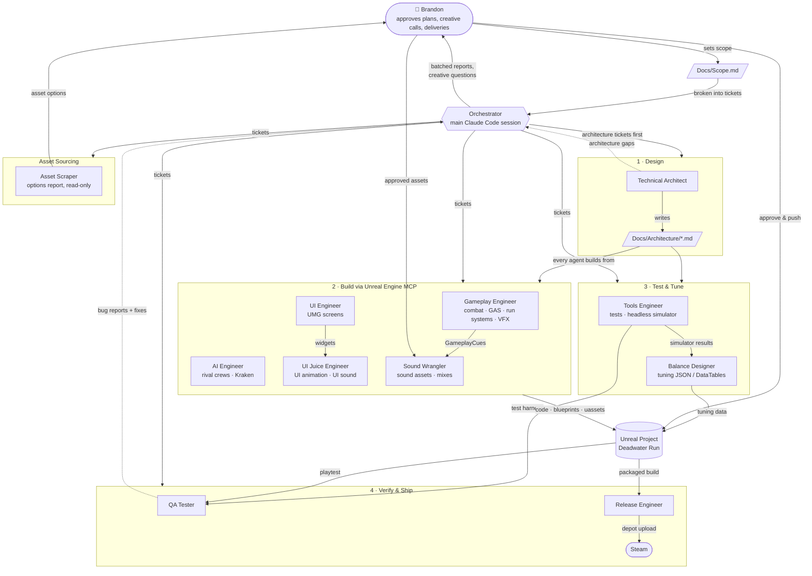

# Deadwater Run

A turn-based pirate roguelike built in Unreal Engine 5.8 by one developer and a crew of coordinated AI agents.

- **Design doc:** [DeadwaterRun.md](DeadwaterRun.md) · **Scope:** [Docs/Scope.md](Docs/Scope.md) · **Architecture:** [Docs/Architecture/](Docs/Architecture/)

## The Game

Lead a pirate crew across the legendary seas of Aquadia and escape by defeating the Kraken.

- **The twist:** every ship has a health bar too. Each fight asks one question:
  - **Sink the ship** - faster fight, 1x loot
  - **Kill the crew** - riskier, but you plunder the ship for 1.5x loot
- **Pick a captain** - each has 2 combat abilities and a run rule that changes how you play:
  - **Team Leader** - crew synergy moves, bodyguarding, Rally Cry, Grapple Hook; crew levels twice as fast
  - **Fearmongerer** - stacks Fear on enemies until they cower or surrender (a third way to win)
  - **The Conqueror** - a sword-only powerhouse with an extra move; grows stronger with every kill
- **Turn-based boarding combat** - ships sit side by side; crew jump between decks, climb the sniper's nest, or fire cannons. Each crew member gets a move and an action (attack, ability, item, or cannon) per turn
- **Permadeath crew** - start with a Captain, Swordsman and Sniper. The fallen are gone for good; recruit replacements at shops (max crew of 4)
- **Branching map** - 8-9 nodes of Fights, Shops and Events (60% good / 40% bad), always moving forward
- **The Kraken** - a two-phase final boss. Cut down its tentacles to limit its attacks before it enrages
- **~30 minute runs** - built for "one more run"

## How It's Built: Coordinated AI Agents

Deadwater Run is built by **11 specialist AI agents** running in Claude Code, each with one area of ownership. They don't work in silos - they share one architecture, one set of GAS tags/attributes, one data layout and one run state.

- **Orchestrator** (main Claude Code session) - turns the scope into tickets and routes each to the agent that owns it. Runs independent tickets in parallel, each in its own git worktree
- **Technical Architect** - writes the architecture docs in `Docs/Architecture/` that every other agent builds from
- **Engineers** - modify the Unreal project directly through the **Unreal Engine MCP**, minimizing hand-holding
- **Tools Engineer** - builds the test harness and headless run simulator, so balance and QA can iterate without burning LLM tokens
- **QA Tester** - verifies every delivery and sends bug reports back to the owning agent
- **Brandon (human)** - approves every plan, every creative decision and every delivery. Agents never push or open PRs

### Agent Roster

| Agent | Input → Output | Owns |
|---|---|---|
| Technical Architect | Prompt → Architecture doc | Module layout, how systems connect, GAS structure, data layout |
| Gameplay Engineer | Doc → MCP → Code/Blueprints | Combat, GAS abilities, map, shop, events, captains, economy, run state, Niagara VFX |
| AI Engineer | Doc → MCP → Code/Blueprints | Rival crew decisions, Kraken behavior |
| UI Engineer | Mockup → MCP → Widget Blueprints | HUD, map, shop, menus |
| UI Juice Engineer | Prompt → MCP → Widget Blueprints | UI animations and UI sounds |
| Tools Engineer | Doc → Editor tool / Test suite | Editor tools, automation tests, headless simulator |
| Balance Designer | Simulator data → Updated JSON/DataTables | Difficulty, costs, loot, ability numbers |
| Sound Wrangler | Approved audio → Sound .uassets | Sound cues, MetaSounds, mixes, combat sound hooks |
| Asset Scraper | Prompt → Asset options report | Finds art/audio/fonts Synty doesn't cover (never imports) |
| QA Tester | Game → Bug report + suggested fix | Breaking the game, verifying deliveries |
| Release Engineer | Build → Packaged build / Checklist | Packaging, Steamworks, store page, deadlines |

### Agent Roles, Connections and Data Flow

### Rules Every Agent Follows

- **Plan first** - code work starts with a plan Brandon approves
- **Proof required** - every delivery includes build result, test output and a screenshot or clip
- **Creative calls stay human** - agents offer 2-3 options; Brandon picks
- **Tracked** - branches are `<agent>/<topic>`, commits end with `Agent: <name>`, and a hook logs every edit and MCP call to `.claude/logs/agent-log.jsonl`
- **Stay in scope** - anything outside `Docs/Scope.md` goes on the post-launch list

Full details: [Docs/Orchestration.md](Docs/Orchestration.md) · Agent definitions: [.claude/agents/](.claude/agents/)
